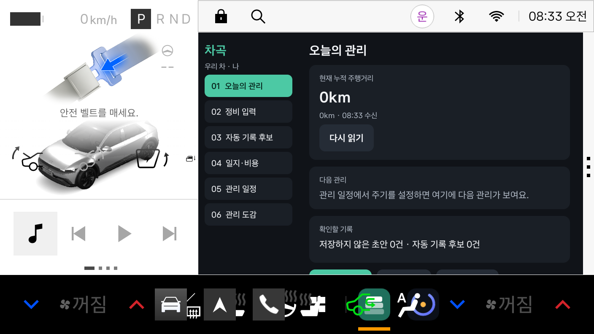
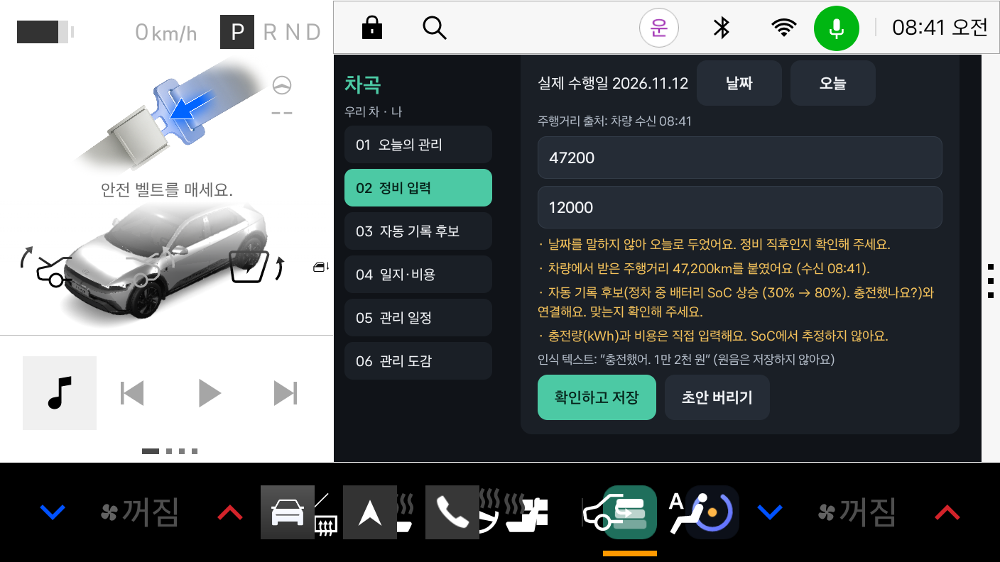
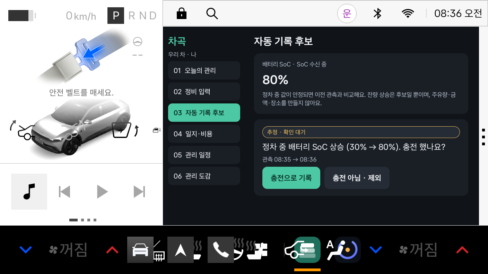
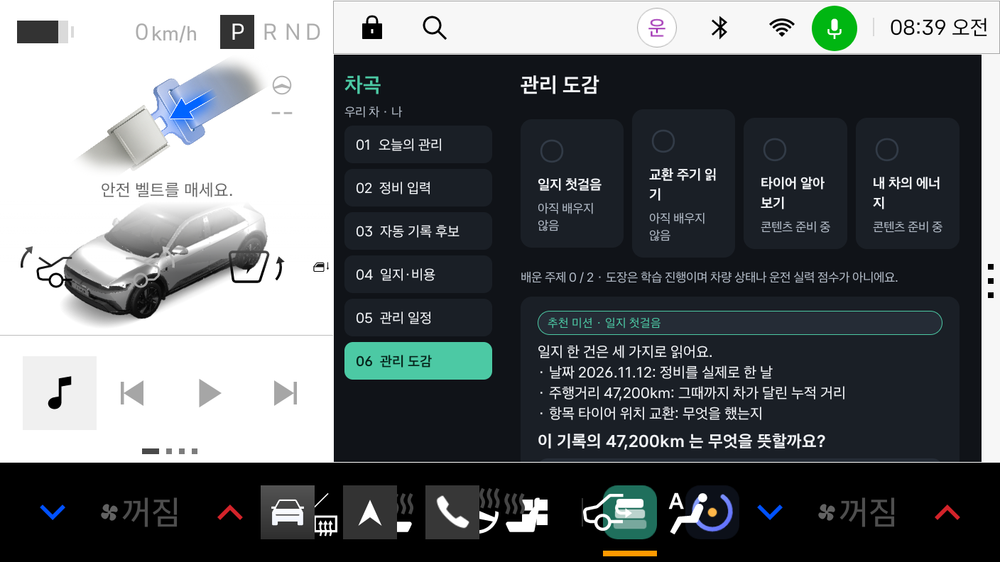

# 차곡 (chagok)

---

- 저절로 정리되고, 관리가 익숙해지는 차량 일지 앱
- 현대자동차그룹 차량용 앱 개발 공모전 출품작으로, **Pleos Connect(Android Automotive OS)** 위에서 동작
- "오늘 엔진오일 갈았어. 8만 원" 한마디로 날짜·누적 주행거리·비용이 붙은 정비 일지 초안 생성
- 사용자가 확인하면 일지·월 비용·다음 관리 일정이 갱신되고, 초보 운전자를 위한 **관리 도감** 미션으로 이어짐
- 음성은 차량 안에서만 처리하고(Pleos STT `ON_DEVICE`), 데이터는 차량 안 로컬 DB에만 저장
- 운영사무국 제약에 따라 **Normal·Dangerous 보호수준 권한만 사용** (signature·privileged 권한 미사용)
- **실행하려면 Pleos Connect Emulator(android-34) 또는 Pleos Connect 차량이 필요**

---

## 스크린샷

- 오늘의 관리: 차량에서 받은 누적 주행거리와 다음 관리



- 정비 입력: 발화로 만든 초안. 주행거리 출처와 확인할 항목을 함께 표시



- 자동 기록 후보: 정차 중 SoC 상승을 충전 후보로 표시하고 사용자 확인을 받음



- 관리 도감: 내 일지로 만든 미션과 주제별 도장



---

## 주요 기능

- 음성 일지 입력: <span style="color:deepskyblue; font-weight:bold">Pleos SpeechToText ON_DEVICE + ko-KR</span>로 발화를 텍스트로 바꾸고, 앱의 발화 사전이 항목·날짜·금액·수정·취소 의도를 해석. 사용할 수 없으면 Android SpeechRecognizer(오프라인 우선)로 대체
- 누적 주행거리 자동 첨부: <span style="color:deepskyblue; font-weight:bold">Vehicle SDK `getCurrentDistanceDriven`</span> 값을 수신 시각과 함께 첨부. 미수신이나 10분보다 오래된 값은 0으로 채우지 않고, 과거 정비에는 오늘 값을 붙이지 않음
- 필드 출처 구분: 모든 주행거리에 <span style="color:deepskyblue; font-weight:bold">차량 수신 / 사용자 입력 / 앱 계산</span> 출처를 남김. 사용자가 고치면 원래 차량 관측값을 따로 보존
- 관리 일정: 사용자가 정한 거리·기간 주기로 다음 관리를 계산하고 <span style="color:deepskyblue; font-weight:bold">먼저 도래하는 조건</span>을 표시. 말일·윤년, 주행거리 역행, 기록 취소 후 재계산 처리
- 차계부: <span style="color:deepskyblue; font-weight:bold">확정된 기록만</span> 월별·항목별로 합산. 금액이 없는 기록은 0원이 아닌 '미입력'으로 따로 셈
- 주유·충전 후보: 정차 중 값이 안정된 <span style="color:deepskyblue; font-weight:bold">연료 잔량·SoC 상승</span>을 후보로 만들고, 사용자가 확인한 뒤에만 일지에 기록. 주유량·충전량·금액을 %에서 추정하지 않음
- 관리 도감: 내 일지 값으로 만든 <span style="color:deepskyblue; font-weight:bold">정차 중 선택형 미션</span>과 주제별 도장. 같은 주제는 중복으로 보상하지 않고, 근거 기록이 취소되면 도장을 다시 검토
- 공용 일지: 가족이 같은 차량 일지를 쓰고, <span style="color:deepskyblue; font-weight:bold">다른 사람이 새로 기록한 관리</span>를 확인
- 정비 리포트: 기간을 선택해 텍스트 파일로 내보냄. <span style="color:deepskyblue; font-weight:bold">VIN과 개인 프로필은 넣지 않음</span>
- 주행 중 제한: <span style="color:deepskyblue; font-weight:bold">CarUxRestrictions</span> 기준으로 일지·일정·학습을 정차 중에만 제공
- 시연 도구: <span style="color:deepskyblue; font-weight:bold">Pleos Virtual Console</span>로 주행거리·SoC·기어 값을 주입하는 스크립트(`tools/vc.sh`) 제공

---

## 개발 환경 구축

### 요구 사항

| 항목 | 버전 / 내용 |
|---|---|
| 운영체제 | Ubuntu 22.04 이상 (Linux x86_64, 하드웨어 가속 에뮬레이터 실행 가능 환경) |
| JDK | 17 (Android Studio에 포함된 JBR 사용 가능) |
| Android Studio | Android Gradle Plugin 9.4.1을 지원하는 버전 |
| Gradle | 9.8.2 (Gradle Wrapper가 자동으로 내려받음) |
| Android SDK | Platform `android-34`, Build-Tools, Platform-Tools(adb), Emulator |
| 시스템 이미지 | Pleos Connect Emulator `android-34 / pleos_car_emulator / x86_64` |
| Pleos SDK | Vehicle 2.3.2, SpeechToText 3.3.1 (Gradle이 Pleos Maven 저장소에서 받음) |
| 기타 | `curl`, `python3` (`tools/vc.sh` 실행용) |

### 1. JDK와 Android Studio 설치

```bash
# 패키지 목록 갱신
sudo apt-get update

# JDK 17 설치 (Android Studio 내장 JBR을 쓸 경우 생략 가능)
sudo apt-get install -y openjdk-17-jdk curl python3

# 설치 확인
java -version
```

Android Studio를 설치한 뒤 **SDK Manager**에서 아래 항목을 설치합니다.

- SDK Platforms: `Android 14.0 (API 34)`
- SDK Tools: `Android SDK Build-Tools`, `Android SDK Platform-Tools`, `Android Emulator`

### 2. Pleos Connect Emulator 설치

Pleos 공식 가이드를 따라 에뮬레이터를 설치하고 AVD를 만듭니다.

- [Pleos Connect SDK 에뮬레이터 설정](https://document.pleos.ai/docs/connect/guide/getting-started/application-development/setup-connect-sdk-emulator): 소프트웨어 개발 환경 요구사항, 에뮬레이터 설치, AVD 생성 및 실행
- [Pleos Connect Emulator 구성](https://document.pleos.ai/docs/connect/guide/getting-started/application-development/configure-pleos-connect-emulator): Virtual Console 설정, 마이크 접근 설정, Cold boot 설정

설치가 끝나면 시스템 이미지가 아래 위치에 있어야 합니다.

```bash
ls ~/Android/Sdk/system-images/android-34/pleos_car_emulator/x86_64
```

> 음성 입력을 시험하려면 가이드의 **마이크 접근 설정**을 반드시 켜야 합니다.

### 3. SDK 경로 설정

프로젝트 루트에 `local.properties`를 만듭니다. 이 파일은 Git에 올리지 않습니다.

```bash
echo "sdk.dir=$HOME/Android/Sdk" > local.properties
```

Pleos SDK는 `settings.gradle.kts`에 등록된 저장소에서 받습니다. 별도 인증은 필요 없습니다.

```kotlin
maven { url = uri("https://nexus-playground.pleos.ai/repository/maven-releases/") }
```

---

## 빌드 방법

### 단위 시험

도메인 로직(발화 해석, 주기 계산, 비용 합계, 후보 감지, 관리 도감, 저장 형식)을 JVM에서 시험합니다. 에뮬레이터 없이 실행됩니다.

```bash
./gradlew :app:testDebugUnitTest
```

### APK 빌드

```bash
./gradlew :app:assembleDebug
```

결과물: `app/build/outputs/apk/debug/app-debug.apk`

### 에뮬레이터에 설치하고 실행

```bash
# 에뮬레이터 실행 (Android Studio Device Manager에서 실행해도 됨)
~/Android/Sdk/emulator/emulator -avd <AVD 이름>

# 설치 (-g: 선언한 런타임 권한 허용)
adb install -r -g app/build/outputs/apk/debug/app-debug.apk

# 실행
adb shell am start -n io.chagok.app/.ui.MainActivity

# 앱 로그 확인
adb logcat -s Chagok:I
```

정상이면 로그에 다음 두 줄이 나옵니다.

```
Chagok  : vehicle initialized
Chagok  : stt ready: Pleos STT · ON_DEVICE · ko-KR
```

### 시연 값 주입 (Virtual Console)

에뮬레이터 안의 Pleos Virtual Console(HTTP 8088)로 차량 값을 넣습니다. 스크립트가 `adb forward`와 Virtual Console 활성화 신호를 함께 처리합니다.

```bash
tools/vc.sh odo 47200     # 누적 주행거리 47,200km
tools/vc.sh soc 30        # SoC 30% (정차 중 10초 이상 유지되면 기준선이 됨)
tools/vc.sh soc 80        # SoC 80%로 상승 → '충전 후보' 생성
tools/vc.sh gear Park     # 기어
tools/vc.sh state         # 현재 값 확인
```

> Virtual Console로 넣은 값은 **가상 값 주입**입니다. 실제 차량에서 받은 값과 구분해서 기록합니다.

### 대표 시연 순서

1. `tools/vc.sh odo 47200`으로 주행거리를 넣고 앱의 **오늘의 관리**에서 수신을 확인
2. **관리 일정**에서 `시연용 예시값 넣기` (10,000km·12개월은 계산 설명용이며 권장 주기가 아님)
3. **정비 입력**에서 "말하기 시작" 또는 예시 발화 선택 → 초안의 날짜·주행거리·비용 확인 → `확인하고 저장`
4. 저장 메시지에서 다음 관리(거리·날짜 중 먼저 오는 조건) 확인
5. **관리 도감**에서 미션을 풀고 도장 받기

---

## 사용 권한

| 권한 | 보호수준 | 사용 API |
|---|---|---|
| `pleos.car.permission.CAR_DRIVE` | normal | `Odometer.checkCurrentDistanceDrivenCapabilities`, `getCurrentDistanceDriven` |
| `pleos.car.permission.CAR_ENERGY` | normal | `Fuel.getFuelPercent` / `registerFuelPercent`, `EvBattery.getEvBatteryStateOfCharge` / `registerEvBatteryStateOfCharge` |
| `pleos.car.permission.STT_SERVICE` | normal | `SpeechToText(Mode.ON_DEVICE)` |
| `android.permission.RECORD_AUDIO` | dangerous | Android SpeechRecognizer 대체 경로 |

보호수준은 Pleos Connect Emulator(android-34)에서 `adb shell dumpsys package permission <권한>`으로 확인한 값입니다.

---

## 프로젝트 구조

```
chagok/
├── assets/                                 # README 스크린샷
├── tools/
│   └── vc.sh                               # Virtual Console 시연 값 주입 스크립트
├── app/
│   ├── build.gradle.kts                    # 앱 모듈 빌드 (Pleos SDK 의존성)
│   └── src/
│       ├── main/
│       │   ├── AndroidManifest.xml         # 권한 선언, 정차 전용 Activity
│       │   ├── res/                        # 아이콘, 색상, 테마, 문자열
│       │   └── java/io/chagok/app/
│       │       ├── domain/                 # SDK에 의존하지 않는 핵심 로직
│       │       │   ├── Model.kt            # 차량 프로필, 일지, 근거 출처, 계획, 후보, 학습 진행
│       │       │   ├── UtteranceParser.kt  # 발화 사전: 항목·날짜·금액·수정·취소 해석
│       │       │   ├── Schedule.kt         # 거리·기간 주기 계산과 도래 판정
│       │       │   ├── Ledger.kt           # 월별·항목별 비용 합계
│       │       │   ├── Detection.kt        # 연료 잔량·SoC 안정 판정과 주유·충전 후보
│       │       │   ├── Learning.kt         # 관리 도감 콘텐츠와 미션
│       │       │   ├── DiaryService.kt     # 초안·확정·수정·취소, 일정, 후보, 도장, 리포트
│       │       │   └── Store.kt            # 저장소 인터페이스와 메모리 구현
│       │       ├── data/
│       │       │   ├── SqliteStore.kt      # 차량 안 로컬 SQLite 저장소
│       │       │   └── Codec.kt            # 도메인 객체 ↔ JSON
│       │       ├── vehicle/
│       │       │   └── PleosVehicle.kt     # Vehicle SDK 어댑터 (capability 확인, 시간 초과, 오류 코드)
│       │       ├── speech/
│       │       │   └── SpeechInput.kt      # Pleos STT ON_DEVICE, Android 대체 경로, 세션 상태
│       │       ├── drive/
│       │       │   └── DrivingState.kt     # CarUxRestrictions 주행 제한
│       │       └── ui/
│       │           ├── MainActivity.kt     # 정차 화면 6개
│       │           └── Ui.kt               # 화면 부품과 색상 팔레트
│       └── test/java/io/chagok/app/domain/ # 단위 시험
├── build.gradle.kts                        # 루트 빌드 (AGP 9.4.1)
├── settings.gradle.kts                     # 저장소 (Google, Maven Central, Pleos)
└── gradlew                                 # Gradle Wrapper
```

---

### 구조

```
┌──────────────────────────────────────────────────────────────────────────────────────┐
│                                  UI (MainActivity)                                   │
│   오늘의 관리 · 정비 입력 · 자동 기록 후보 · 일지·비용 · 관리 일정 · 관리 도감        │
└───────┬───────────────────┬────────────────────┬───────────────────────┬─────────────┘
        │ 최종 인식 텍스트   │ 주행거리·잔량       │ 주행 제한              │ 확인·수정·취소
        ▼                   ▼                    ▼                       ▼
┌───────────────┐   ┌────────────────┐   ┌────────────────┐   ┌─────────────────────────┐
│ SpeechInput   │   │ PleosVehicle   │   │ DrivingState   │   │ DiaryService (domain)   │
│ Pleos STT     │   │ capability →   │   │ CarUx          │   │ ├ UtteranceParser       │
│ ON_DEVICE     │   │ get / register │   │ Restrictions   │──▶│ ├ ScheduleCalculator    │
│ (Android 대체)│   │ 시간 초과 3초   │   │                │   │ ├ Ledger                │
└───────┬───────┘   └───────┬────────┘   └────────────────┘   │ ├ EnergyTracker         │
        │                   │                                 │ └ LearningCatalog       │
        ▼                   ▼                                 └────────────┬────────────┘
┌───────────────┐   ┌────────────────┐                                     │
│ Pleos Speech  │   │ Pleos Vehicle  │                                     ▼
│ Service       │   │ Service (IPC)  │                       ┌─────────────────────────┐
│ (차량 내 엔진)│   │                │                       │ SqliteStore (로컬 DB)    │
└───────────────┘   └────────────────┘                       └─────────────────────────┘

데이터 흐름:
- 음성 입력: SpeechInput → 최종 텍스트 → 주행거리 조회 → DiaryService.handleVoice → 초안(DRAFT)
- 저장: 사용자 확인 → DiaryService.confirm → 확정(CONFIRMED) → 비용·일정·도감 갱신
- 후보: 잔량 리스너 + 5초 주기 재입력 → EnergyTracker(정차·안정 판정) → 후보(PENDING) → 사용자 확인
- 비동기 결과: Vehicle·STT 콜백은 모두 메인 스레드로 옮겨 처리
```

---

## 검증 현황

| 항목 | 상태 |
|---|---|
| 단위 시험 39건 (발화 사전, 금액 표현, 주기 계산 경계, 비용 합계, 후보 감지, 도장 중복 방지, 저장 형식) | 통과 |
| 일반 앱 설치 상태에서 Vehicle 서비스 연결과 누적 주행거리 수신 | 에뮬레이터 확인 (주입 값) |
| SoC 구독과 충전 후보 생성, 발화와 후보 연결 | 에뮬레이터 확인 (주입 값) |
| Pleos STT ON_DEVICE 초기화와 인식 세션 시작, 무음 종료 처리 | 에뮬레이터 확인 |
| 대표 시연 흐름과 앱 재실행 후 초안 유지 | 에뮬레이터 확인 |
| 실제 한국어 발화 인식 결과 | 미확인 (마이크 입력 환경 필요) |
| 실차 수신, 주행 중 차단 동작, 초보 사용자 사용성 평가 | 미확인 |

---

## 범위

- 구현: 기획서 v4.2의 P0(STT + 누적 주행거리)와 P1(일지 → 일정 → 도감, 주유·충전 후보, 도장 2종)
- 미구현: P2(액체류 상태 이력, 연비·전비 추이, 와이퍼, VIN 연계)
- 제외: 전체 경고등 타임라인(`registerTelltales`, 제한 권한), 바퀴별 저압 발생 횟수(`getLowTirePressure`는 임계값 반환)
- 공유: 서버 동기화 없이 같은 차량의 공용 일지, 변경 사항 확인, 리포트 내보내기로 구현

---

## 라이선스

이 프로젝트는 MIT 라이선스를 따릅니다. 자세한 내용은 [LICENSE](LICENSE) 파일을 참고하세요.

---
