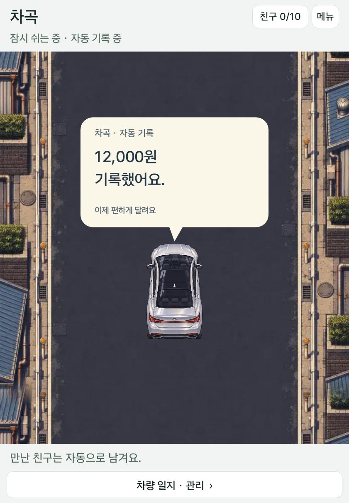
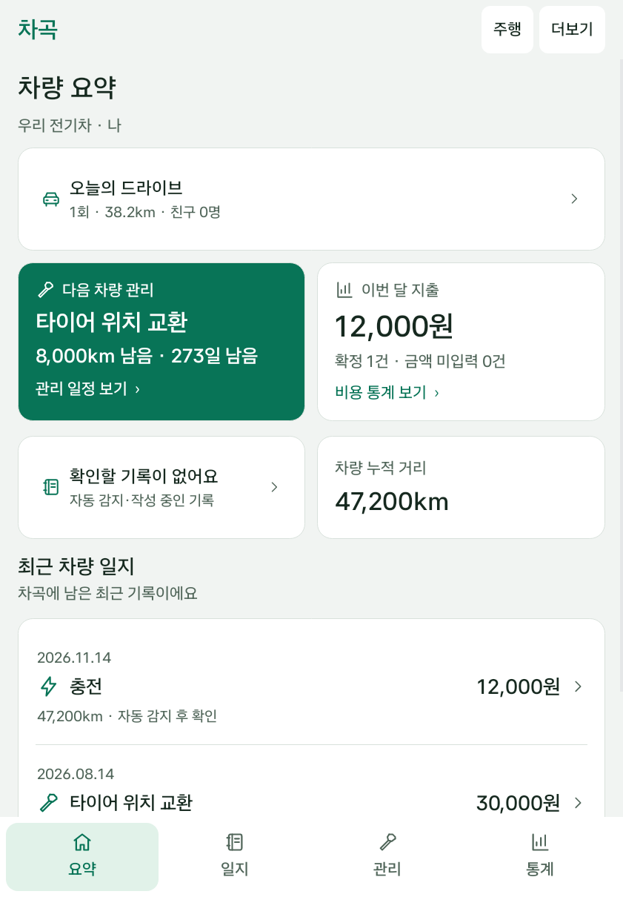
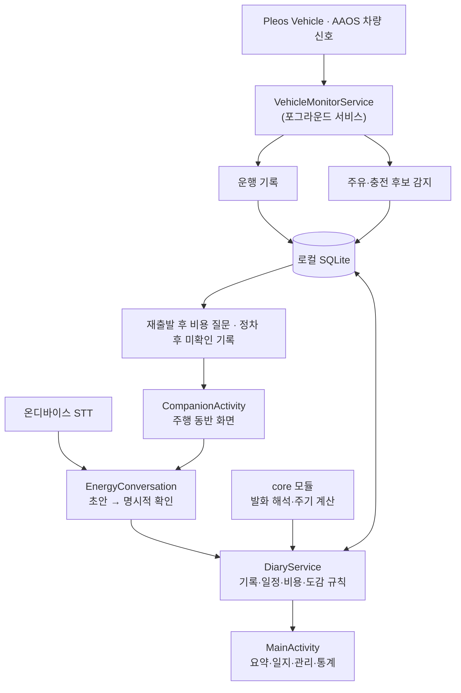

# 차곡 · chagok

**운행을 자동으로 기록하고, 충전·주유 뒤 다시 출발하면 비용을 묻는 차량 일지.**

차곡은 **Pleos Connect(Android Automotive OS)** 에서 실행하는 차량용 앱입니다. 누적 주행거리·연료 잔량·배터리 SoC·주행 상태처럼 차가 이미 알고 있는 값으로 운행과 주유·충전을 기록합니다. 사람은 차가 알 수 없는 것, 즉 **금액과 실제로 한 정비**만 말로 확인합니다. 확인한 기록은 일지·비용 통계·다음 관리 일정·관리 도감으로 이어집니다.

> 전기차로 38.2km를 달리고 충전했습니다. 다시 출발하자 차가 “충전비, 얼마였어요?”라고 묻습니다. “1만 2천 원”, “맞아.” 두 마디로 오늘의 운행과 충전 기록, 이번 달 비용이 정리됩니다.

<table>
<tr>
<td width="33%"><b>① 내비 옆 주행 화면</b><br></td>
<td width="33%"><b>② 충전비 질문</b><br></td>
<td width="33%"><b>③ 명시적 확인 후 저장</b><br></td>
</tr>
<tr>
<td><b>④ 하루 요약</b><br></td>
<td><b>⑤ 차량 일지</b><br></td>
<td><b>⑥ 다음 관리</b><br></td>
</tr>
</table>

위 화면은 실제 앱의 View를 시연 데이터로 캡처한 것입니다. 운행 이력은 재현용 데이터이고, 충전 후보는 실제 감지 로직에 SoC 표본을 넣어 만들었으며, 음성 문장은 STT 결과 경로에 주입했습니다. 실차 주행이나 마이크 인식을 증명하는 화면은 아닙니다. 캡처 방법은 [테스트와 시연 도구](#테스트와-시연-도구)를 참고하세요.

**핵심 데모** · 내비 옆 세로 주행과 빗길 가로 주행, 충전비 확인, 정비소 방문, 차량 일지와 비용·도로별 통계를 한 편에 담았습니다. [차곡 데모 보기 · 6분 08초](demo/chagok-demo.mp4)

**개별 시연** · [정비소 입출차](doc/demo/workshop-visit.mp4) · [가로 창 주행 미리보기](doc/design/landscape-v11/android-evidence/native-landscape-preview.mp4)

## 공모전 제출 정보

| 항목 | 내용 |
|---|---|
| 앱 이름 | **차곡 (chagok)** · 팀 차곡차곡 |
| 한 줄 소개 | 차량 신호로 운행·주유·충전을 모아 두고, 재출발 후 한마디로 비용을 확인해 일지에 남기는 차량 일지 앱 |
| APK | [GitHub Release v0.1.0](https://github.com/loki2001-dev/chagok/releases/tag/v0.1.0)의 `차곡차곡_차곡_release.apk` (약 131MB). GitHub의 저장소 파일 크기 제한(100MB)을 넘어 Release에 등록했습니다. [apk/](apk/README.md) 참고 |
| 패키지 / 시작 화면 | `io.chagok.app` / `io.chagok.app.companion.CompanionActivity` |
| 실행 방법 | [아래 요약](#실행-방법-요약) · 자세한 내용은 [개발 환경 구축 및 빌드](#개발-환경-구축-및-빌드) |

### 테스트 환경

| 항목 | 내용 |
|---|---|
| 에뮬레이터 | **Pleos Connect v2.1.0** 시스템 이미지 (`pleos_car_emulator`, Android 14 / API 34, x86_64) |
| 화면 규격 | **1408 × 792 px, 160dpi (가로)** · RAM 4GB · Cold boot |
| Android Emulator | 37.2.12 |
| 차량 값 | Pleos Connect Virtual Console로 주행거리·SoC·연료·속도·기어·방향지시등·와이퍼 주입 |
| 개발 PC | Linux(Ubuntu) x86_64 + KVM · Windows + WHPX |

### 필요한 설정

1. 설치할 때 `-g` 옵션으로 런타임 권한을 함께 허용합니다. 차량 권한(`CAR_DRIVE`, `CAR_ENERGY` 등)은 Normal 권한이라 자동으로 허용되고, 마이크와 위치 권한은 앱을 쓰는 중에 물어봅니다.
2. 앱을 처음 실행하면 정차 상태(P단)에서 **차량 종류 선택 → 자동 기록 안내 → 자동 기록 시작**을 진행합니다.
3. 주유·충전 감지를 확인하려면 Virtual Console에서 P단으로 둔 뒤 SoC(전기차) 또는 연료(내연기관) 값을 5%p 이상 올립니다.
4. 장소 방문 확인과 도로별 주행 통계는 선택 기능입니다. 정차 중 **더보기 → 도로·정비소·주유소 감지 설정**에서 켜고 위치 권한을 허용합니다.

### 실행 방법 요약

```bash
# Pleos Connect v2.1.0 에뮬레이터를 켠 뒤
adb install -r -g 차곡차곡_차곡_release.apk
adb shell am start -n io.chagok.app/.companion.CompanionActivity
```

## 목차

- [공모전 제출 정보](#공모전-제출-정보)
- [핵심 원칙](#핵심-원칙)
- [주요 기능](#주요-기능)
- [차량 연동과 권한](#차량-연동과-권한)
- [앱 구조](#앱-구조)
- [개발 환경 구축 및 빌드](#개발-환경-구축-및-빌드)
- [테스트와 시연 도구](#테스트와-시연-도구)
- [현재 한계](#현재-한계)
- [문서와 자료](#문서와-자료)

## 핵심 원칙

| 원칙 | 앱의 동작 |
|---|---|
| 자동으로 모으되, 저장은 확인한 것만 | 감지 후보와 음성 초안은 사용자가 “맞아”라고 확인하기 전까지 일지·비용에 들어가지 않습니다. 침묵이나 화면 이탈은 저장이 아닙니다. |
| 받지 못한 값은 0이 아니다 | 차량 값을 받지 못하면 0km·0원으로 채우지 않고 미수신으로 표시합니다. 금액 미입력과 무료(0원)도 구분합니다. |
| 추정은 추정으로 | 잔량 상승은 주유·충전 **후보**일 뿐입니다. 퍼센트로 결제 금액·주유량(L)·충전량(kWh)을 역산하지 않습니다. |
| 값의 출처를 남긴다 | 주행거리 등 필드마다 `차량 수신 / 사용자 입력 / 앱 계산`과 수신 시각을 보관하고, 사용자가 고쳐도 원래 관측값을 유지합니다. |
| 주행 중에는 음성으로 확인 | 일지 편집·설정·학습은 `CarUxRestrictions`에 따라 정차 중에만 열립니다. 방금 충전·주유한 비용은 재출발 후 음성으로 확인합니다. |
| 차 밖으로 보내지 않는다 | 일지는 차량 안 SQLite에 저장합니다. 원음은 보관하지 않고, 음성 인식은 온디바이스로 처리합니다. |

## 주요 기능

### 1. 자동 운행 기록

포그라운드 서비스 `VehicleMonitorService`가 속도·기어·누적 주행거리를 관측합니다. 내비게이션을 크게 열거나 차곡 화면을 닫아도 수집이 이어집니다.

| 상황 | 처리 |
|---|---|
| 속도가 0.5m/s를 넘음 | 운행 시작 또는 진행 중인 운행에 연결 |
| P단·정지가 120초 이어짐 | 운행 종료. 종료 시각은 정차가 시작된 시각 |
| 누적 주행거리 수신 | 시작과 종료 값의 차이로 거리 계산(GPS 경로 합산이 아님) |
| 신호가 끊김 | 끊긴 시간을 이동 시간으로 채우지 않고 누락으로 표시 |
| 사용자 변경·시계 역행·30분 넘는 공백 | 이전 운행을 불완전 기록으로 닫음 |

운행 상태는 약 5초마다 저장하고, 자동 기록을 켜 두면 부팅이나 앱 업데이트 뒤 수집을 다시 시작합니다. OS가 앱을 강제로 멈추는 경우까지 항상 실행된다는 뜻은 아닙니다.

### 2. 주유·충전 감지와 재출발 후 음성 확인

내연기관·하이브리드는 **연료 잔량**, 전기차는 **배터리 SoC**를 봅니다.

1. 정차 중 약 10초 동안 안정된 값(허용 폭 1%p)을 기준으로 삼습니다.
2. 기준에서 누적 상승이 5%p 이상이면 후보를 만듭니다. 천천히 오르는 완속 충전도 누적합니다.
3. 같은 상승 과정은 후보 하나로 갱신하고, 이미 확정·제외한 사건을 다시 만들지 않습니다.
4. 2분을 넘는 관측 공백이 있었다면 그 사실을 후보에 표시합니다.

정차 중 잔량 상승이 감지되면 충전소 또는 주유소 입차 연출이 시작됩니다. 전진 기어로 다시 움직이면 음성 서비스와 마이크를 사용할 수 있고 통화 중이 아닐 때 이번 비용을 한 번 묻습니다. 미룬 기록은 정차 후 이어서 확인할 수 있습니다.

| 사용자의 말 | 결과 |
|---|---|
| “1만 2천 원” | 12,000원 초안을 만들고 저장 여부를 확인 |
| “맞아”, “저장해” | 기록 확정 |
| “2만 원이 아니라 1만 2천 원” | 금액을 고쳐 다시 확인 |
| “금액 몰라” / “무료” | 금액 미입력 / 명시적 0원으로 저장할지 확인 |
| “나중에”, “취소”, 20초 무응답 | 비용에 넣지 않고 초안으로 보관 |
| “오늘은 묻지 마” | 그날 추가 질문을 쉼 |
| “충전한 게 아니야” | 후보 제외 |

### 3. 한마디 정비 기록

“오늘 엔진오일 갈았어. 8만 원”처럼 말하면 항목·날짜·금액을 해석해 초안을 만들고, 최근 10분 안에 받은 차량 주행거리를 붙입니다. “지난주에 오일 갈았어”처럼 과거 정비라면 오늘의 주행거리를 붙이지 않고 당시 값을 따로 확인합니다. 해석은 규칙과 발화 사전 기반이며 클라우드 LLM을 쓰지 않습니다.

지원 항목: 엔진오일·변속기 오일·브레이크 오일·냉각수 교환, 드라이브 벨트·점화플러그·점화코일·에어컨 필터 교체, 타이어 위치 교환·교체, 브레이크 패드·12V 배터리·와이퍼 점검과 교체, 워셔액 보충, 주유, 충전, 기타 정비, 증상 메모. 차량 종류에 맞지 않는 항목(예: 전기차의 엔진오일)은 표시하지 않습니다.

### 4. 관리 일정 · 비용 통계 · 관리 도감

- **관리 일정:** 소모품 권장 주기표를 기본값으로 등록하고, 사용자가 거리·개월 주기와 출처를 고칠 수 있습니다. 다음 관리는 **거리와 기간 중 먼저 오는 조건**으로 계산합니다. 첫 주행 때 “마지막으로 정비한 주행거리가 몇 km였나요?”라고 한 번 물어 첫 기준점을 잡습니다.
- **비용 통계:** 확정되고 취소되지 않은 기록만 월별·항목별로 합산하고 6개월 추이를 보여 줍니다. 수정·취소하면 다시 계산합니다.
- **관리 도감:** 내 일지로 짧은 설명과 선택형 미션을 만들고 주제별 도장을 줍니다. 현재 주제는 *일지 첫걸음*, *교환 주기 읽기*입니다. 같은 주제의 도장은 중복 지급하지 않고, 근거 기록이 취소되면 재검토 상태가 됩니다.

### 5. 주행 동반 화면

내비게이션 옆 창에 차와 풍경을 그립니다. 앱에 배정된 실제 창 비율에 맞춰 세로(위로 전진) 또는 가로(2.5D, 왼쪽에서 오른쪽) 장면을 고릅니다.

- 속도에 따라 도로 흐름이 바뀌고, **방향지시등**에 맞춰 차선을 옮기며, **와이퍼**가 60초 이상 작동하면 비가 내립니다.
- 스킨은 *네온 레이서*와 *현대 세단* 두 가지입니다.
- 도시·시골의 10가지 장면에서 가끔 친구를 만나고, 실제로 화면에 1.5초 이상 보인 만남만 수집합니다.
- 주행 중 `NO_VIDEO` 제한이 오면 애니메이션을 멈춥니다. 기록 수집은 화면과 별개로 계속됩니다.

### 6. 선택 기능: 장소 방문 확인과 도로별 주행 통계

둘 다 기본으로 꺼져 있고, 정차 중 설정에서 켜며 Pleos 위치 권한이 필요합니다. 위치는 차 밖으로 보내지 않습니다.

- **정비소·주유소 방문 확인:** 전국 공개 목록(정비소 34,061곳, 주유소 5,506곳)과 비교해 한 업체 60m 안에서 60초 이상 정차하면 방문 후보를 만듭니다. 후보는 확인 전까지 일지가 아닙니다. → [목록 출처와 정제 기록](data/places/README.md) · [방문 감지 설명](doc/place-visits.md)
- **도로별 주행 통계:** 앱에 포함된 전국 OSM 도로 팩과 대조해 고속도로·간선도로·일반도로 등 등급별 거리와 시간을 누적합니다. 좌표나 궤적은 저장하지 않고 일 단위 합계만 남깁니다. → [도로 통계 설명](doc/roads/README.md)

### 7. 공용 일지와 정비 리포트

- 같은 차 안에서 이름으로 사용자를 전환하고, 내 확정 기록의 열람 범위를 **모두 / 지정한 이름 / 나만** 중에서 정합니다. 이름 전환은 로그인이 아니며 클라우드 동기화도 없습니다.
- 기간·항목을 골라 텍스트 리포트를 만들고 `FileProvider`로 공유합니다. VIN과 작성자 이름은 넣지 않습니다.

## 차량 연동과 권한

| 데이터·기능 | 사용 경로 | 쓰임 |
|---|---|---|
| 누적 주행거리 | Pleos Vehicle `Odometer.getCurrentDistanceDriven` | 운행 거리, 일지 첨부, 관리 일정 |
| 연료 잔량 / 배터리 SoC | Pleos Vehicle Fuel · EvBattery | 주유·충전 후보 |
| 방향지시등 / 와이퍼 | Pleos Vehicle 신호 | 차선 이동·비 연출 |
| 속도·기어 | AAOS `CarPropertyManager` | 운행 시작·종료, 정차 판단 |
| 주행 제한 | AAOS `CarUxRestrictionsManager` | 조작 화면 제한, 연출 정지 |
| 음성 인식 | Pleos SpeechToText `ON_DEVICE`, `ko-KR` (대체: Android 온디바이스 엔진) | 금액 확인, 정비 기록 |
| 위치 | Pleos FusedLocation | 장소 방문·도로 통계(선택) |

모든 SDK 호출은 권한과 capability를 먼저 확인하고, 실패하면 `Reading.Unavailable`로 다룹니다. 권한은 공모전 운영 조건에 따라 **Normal·Dangerous 범위만** 사용하고 signature·privileged 권한은 선언하지 않습니다.

| 권한 | 이유 |
|---|---|
| `pleos.car.permission.CAR_DRIVE` · `CAR_ENERGY` | 누적 주행거리 · 연료/SoC |
| `pleos.car.permission.CAR_LIGHTS` · `CAR_WINDOWS` | 방향지시등 · 와이퍼 |
| `android.car.permission.CAR_SPEED` · `CAR_POWERTRAIN` | 속도 · 기어 |
| `pleos.car.permission.STT_SERVICE` · `android.permission.RECORD_AUDIO` | 음성 입력(사용자가 시작할 때) |
| `pleos.car.permission.FUSED_LOCATION` | 선택 기능의 위치 (런타임 요청) |
| `FOREGROUND_SERVICE` · `FOREGROUND_SERVICE_SPECIAL_USE` · `POST_NOTIFICATIONS` | 화면 밖 자동 기록과 상태 알림 |
| `RECEIVE_BOOT_COMPLETED` | 부팅 후 자동 기록 재개 |
| `INTERNET` | HTTPS 장소 목록 다운로드만. 좌표·일지·음성은 보내지 않음 |

정확한 선언은 [AndroidManifest.xml](app/src/main/AndroidManifest.xml)에 있습니다.

## 앱 구조



| 모듈·폴더 | 내용 |
|---|---|
| `app/.../companion` | 주행 동반 화면, 세로·가로 장면 렌더러, 정비소 장면, 백그라운드 기록 서비스, 금액·정비 대화 |
| `app/.../domain` | 일지 모델, `DiaryService`, 주유·충전 감지, 자동 운행 기록, 비용, 관리 도감, 장소 방문 |
| `app/.../data` | `SqliteStore`(JSON 문서를 SQLite에 저장), 직렬화, 장소 목록 |
| `app/.../vehicle` · `speech` · `drive` | Pleos Vehicle·위치 어댑터, 음성 입력, 주행 제한 |
| `app/.../roads` | OSM 도로 팩 대조와 도로별 통계 |
| `app/.../ui` | 정차 중 화면(요약·일지·관리·통계·설정) |
| `core/` | 순수 Kotlin 일지 규칙 엔진. 발화 해석과 관리 주기 계산을 앱이 위임 |
| `app/src/smoke` · `androidTest` | 테스트 전용 앱 변형, 기기 스모크·캡처 테스트 |
| `tools/` | 실행·테스트·시연·데이터 변환 스크립트 |

UI는 Android View와 Canvas로 직접 그립니다(Compose·WebView 미사용). Room·DI 프레임워크·분석 SDK 없이 `SQLiteOpenHelper`와 JSON 직렬화를 사용합니다.

## 개발 환경 구축 및 빌드

앱은 `android.hardware.type.automotive`를 요구하므로 **Pleos Connect Emulator 또는 Pleos 차량**에서만 실행됩니다. 일반 휴대전화 에뮬레이터에는 설치되지 않습니다.

### 필요한 것

| 항목 | 버전·내용 |
|---|---|
| JDK | **25** (Gradle Daemon JVM. `gradle/gradle-daemon-jvm.properties`가 지정, 없으면 자동으로 받음) |
| Android Studio | AGP 9.4.1을 지원하는 버전 |
| Android SDK | Platform 34, Build-Tools, Platform-Tools, Emulator |
| Pleos 시스템 이미지 | Pleos Connect API 34 (`pleos_car_emulator`, x86_64) |
| Python 3 | 스모크·캡처·시연 도구 (표준 라이브러리만 사용) |
| 네트워크 | 첫 빌드 때 Gradle과 Pleos Maven 저장소 의존성 다운로드 |

빌드 구성 버전: AGP 9.4.1 · Gradle 9.8.2 · Kotlin(AGP 내장) · compileSdk/targetSdk 34 · minSdk 28 · Java 소스 호환 17 · Pleos Vehicle 2.3.2 · SpeechToText 3.3.1 · FusedLocation 1.1.3.

### 1. Pleos 에뮬레이터 준비

1. Android Studio의 SDK Manager에서 Platform 34, Build-Tools, Platform-Tools, Emulator를 설치합니다.
2. [Pleos 공식 설치 안내](https://document.pleos.ai/docs/connect/guide/getting-started/application-development/setup-connect-sdk-emulator)에 따라 SDK Update Site를 추가하고 Pleos API 34 시스템 이미지를 설치합니다.
3. Device Manager에서 Automotive / Pleos AVD를 만듭니다. RAM 4GB, Cold boot를 권장합니다. 하드웨어 가속(Linux KVM, Windows WHPX)이 필요합니다.

### 2. 저장소 받기와 SDK 경로 지정

```bash
git clone https://github.com/loki2001-dev/chagok.git
cd chagok
```

프로젝트 루트에 `local.properties`를 만들고 SDK 경로를 적습니다. 이 파일은 Git에서 제외됩니다.

```properties
# Linux / macOS
sdk.dir=/home/<사용자>/Android/Sdk
# Windows
# sdk.dir=D:/Android/Sdk
```

Pleos Maven 저장소는 [settings.gradle.kts](settings.gradle.kts)에 이미 등록되어 있습니다.

```kotlin
maven { url = uri("https://nexus-playground.pleos.ai/repository/maven-releases/") }
```

### 3. 빌드와 테스트

Linux / macOS:

```bash
./gradlew :core:test                 # 일지 규칙 엔진 테스트 (Android SDK 불필요)
./gradlew :app:testSmokeUnitTest     # 앱 JVM 테스트 (에뮬레이터 불필요)
./gradlew :app:assembleDebug         # APK → app/build/outputs/apk/debug/app-debug.apk
```

Windows(PowerShell)에서는 `./gradlew` 대신 `.\gradlew.bat`을 씁니다.

### 4. 에뮬레이터에 설치하고 실행

```bash
adb install -r -g app/build/outputs/apk/debug/app-debug.apk
adb shell am start -n io.chagok.app/.companion.CompanionActivity
```

처음 실행하면 정차 상태에서 **차량 종류 선택 → 자동 기록 안내 → 자동 기록 시작** 순서로 진행합니다. 마이크 권한은 음성 입력을 처음 쓸 때, 위치 권한은 선택 기능을 켤 때 요청합니다.

### Windows 전용 스크립트

저장소 안 `.dev/`에 Android Studio·SDK·AVD를 둔 Windows 작업 폴더용 스크립트가 있습니다. `.dev/`는 Git에 포함되지 않으므로 새로 clone한 PC에서는 위 1~4단계로 직접 준비해야 합니다.

```powershell
. .\tools\dev-env.ps1          # 현재 터미널에 Java·SDK·AVD 경로 적용
.\tools\run-windows.ps1        # 빌드 → 에뮬레이터 부팅 → 설치 → 실행 (-SkipBuild 지원)
.\tools\studio-windows.ps1     # 같은 경로로 Android Studio 실행
```

스크립트가 실행 정책에 막히면 현재 터미널에서만 `Set-ExecutionPolicy -Scope Process Bypass`를 적용합니다.

### 빌드 변형

| 변형 | 패키지 | 용도 |
|---|---|---|
| `debug` | `io.chagok.app` | 일반 개발 앱 |
| `smoke` | `io.chagok.app.smoke` | 데이터가 분리된 테스트·시연 앱. 기기 테스트가 실제 사용자 일지를 지우지 않음 |
| `release` | `io.chagok.app` | 현재 debug 서명·난독화 없음. 배포 전 서명 구성 필요 |

## 테스트와 시연 도구

| 범위 | 확인하는 내용 | 실행 |
|---|---|---|
| core 단위 테스트 | 발화 해석, 주기 계산, 감지·학습 규칙 | `./gradlew :core:test` |
| 앱 JVM 테스트 | 금액 해석, 후보 감지, 비용 합계, 출처·수정, 운행 분리, 질문 미루기, 직렬화 | `./gradlew :app:testSmokeUnitTest` |
| 기기 스모크 | 화면 이동, 저장·수정·취소, Virtual Console → SDK → 앱 신호 반영 | `python tools/smoke-device.py` (Windows: `tools\smoke-windows.ps1`) |
| 재부팅 검증 | 앱을 열지 않아도 자동 기록 서비스가 재개되는지 | `python tools/verify-auto-boot.py` |
| README 화면 캡처 | 후보 → 금액 초안 → 확정 → 일지·통계 10개 화면 | `python tools/capture-readme.py` |

기기 스모크와 캡처는 `smoke` 앱의 데이터만 초기화합니다. Virtual Console 신호는 에뮬레이터 전체에 영향을 주므로, 테스트 중에는 같은 에뮬레이터에서 앱을 직접 조작하지 마세요. 연결된 기기는 하나여야 합니다.

```bash
# 특정 기기 테스트만 실행
python tools/smoke-device.py --class io.chagok.app.CompanionSmokeTest

# README 화면 다시 만들기
./gradlew :app:assembleSmoke :app:assembleSmokeAndroidTest
adb install -r -g app/build/outputs/apk/smoke/app-smoke.apk
adb install -r -g app/build/outputs/apk/androidTest/smoke/app-smoke-androidTest.apk
python tools/capture-readme.py
```

| 시연 도구 | 내용 |
|---|---|
| `tools/vc.sh` | Virtual Console로 누적 주행거리·SoC·기어 값 주입 (Linux/macOS) |
| `tools/presentation-demo.py` · `demo-windows.ps1` | 주행 → 깜빡이 → 급가속 → 정차·주유 → 금액 확인까지 발표용 연속 시연 |
| `tools/demo-fuel-workshop.sh` | 주유·정비소 시나리오 녹화본을 한 영상으로 합성 |
| `tools/landscape-demo.py` · `parked-diary-demo.py` · `companion-split-demo.py` | 가로 창·정차 일지·분할 창 녹화와 점검 |
| `tools/demo-record.sh` · `demo-render.py` | 초기 일지 UI의 전체 시나리오 녹화와 자막 합성 |
| `tools/build_place_catalogue.py` · `tools/roads/` | 장소 목록과 도로 팩 생성 |

시연 도구의 연료 상승과 음성 답변은 재생값입니다. 실제 감지·확정·SQLite·화면 로직은 그대로 사용하지만, 실차 수신이나 마이크 인식을 증명하지는 않습니다.

## 현재 한계

- **실차 검증 전입니다.** 모든 동작은 Pleos Connect Emulator와 Virtual Console 주입 값으로 확인했습니다. 잔량 감지 기준과 한국어 인식률은 실차에서 다시 맞춰야 합니다.
- **주행 중 애니메이션 범위가 미정입니다.** 일반 앱은 주행 중 `NO_VIDEO` 제한을 받으면 연출을 멈춥니다. 실제 차량에서 어디까지 움직이는 화면을 허용받을지는 Pleos 정책 확인이 필요합니다.
- **감지는 추정입니다.** 충전 커넥터 해제나 결제 완료를 직접 읽지 않으므로 충전 직후 바로 질문한다고 보장하지 않습니다.
- **에뮬레이터 성능:** 가로 화면 녹화 때 지연 프레임이 관측되었습니다. 실차 30fps는 검증하지 않았습니다. → [측정 근거](doc/design/landscape-v11/verification.json)
- **아직 없는 기능:** 클라우드 동기화·가족 계정 인증, 스마트폰 연동, 고장 진단, 영수증 OCR, 충전 결제 조회, 내비게이션 경로·회전 안내 연동, 실제 강우량·도시/시골 환경 판정.

## 문서와 자료

| 자료 | 내용 |
|---|---|
| [시각 기획서 v4.2](doc/차곡_차량일지자동화_시각기획서_v4.2.html) | 공모전 출품 기획. 이후 구현 변경은 이 README와 코드 기준 |
| [첫 실행 UX](doc/design/first-run-ux/README.md) | 첫 실행·기록 중심 홈 화면 |
| [자동 일지 v10](doc/design/auto-diary-v10/index.html) | 자동 기록·질문·재부팅 검증 |
| [가로 주행 v11](doc/design/landscape-v11/index.html) | 가로 2.5D 장면, 스킨 비교, 영상 |
| [전체 UI v9](doc/design/ui-v9/index.html) | 일지·관리·통계 화면 점검 |
| [차량 SDK 검증](doc/design/companion-v6/android-integration.txt) · [분할 창 검증](doc/design/companion-v6/split-window-verification.txt) | 실제 SDK 신호와 내비 옆 창 배치 |
| [시연 순서](doc/demo/scenario.txt) | 발표용 시연 흐름 |
| [core 모듈](core/README.md) | 일지 규칙 엔진 설명 |

## 기여

커밋 메시지 형식(`ADD.` · `FIXED.` · `UPDATE.` · `MERGE.` + 한국어 설명)과 `--no-ff` 병합 절차는 [CONTRIBUTING.md](CONTRIBUTING.md)를 따릅니다.

## 라이선스

코드는 [MIT](LICENSE)입니다. Asta Sans 글꼴은 [SIL Open Font License](app/src/main/assets/licenses/AstaSans-OFL.txt), 도로 팩은 OpenStreetMap 자료로 [ODbL 1.0](app/src/main/assets/roads/ODbL-1.0.txt), 장소 목록은 [공공데이터포털 공개 표준데이터](data/places/README.md)를 따릅니다. Pleos SDK는 각 이용 조건을 따릅니다.
