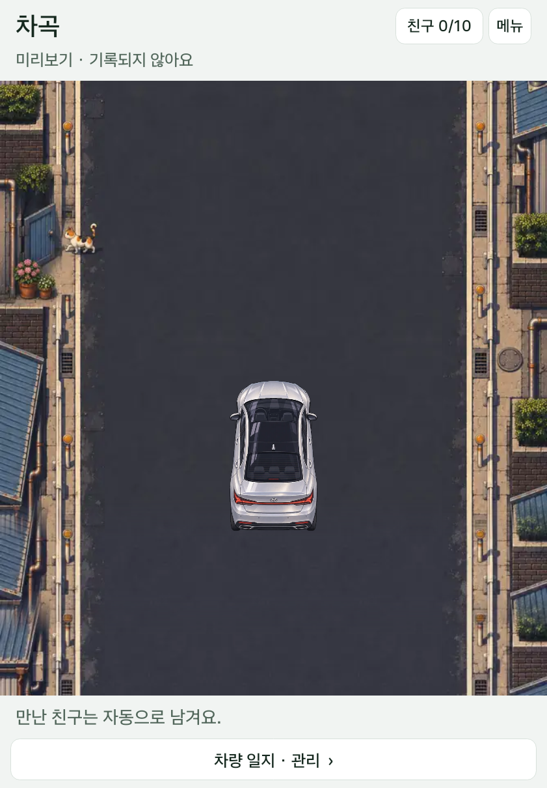
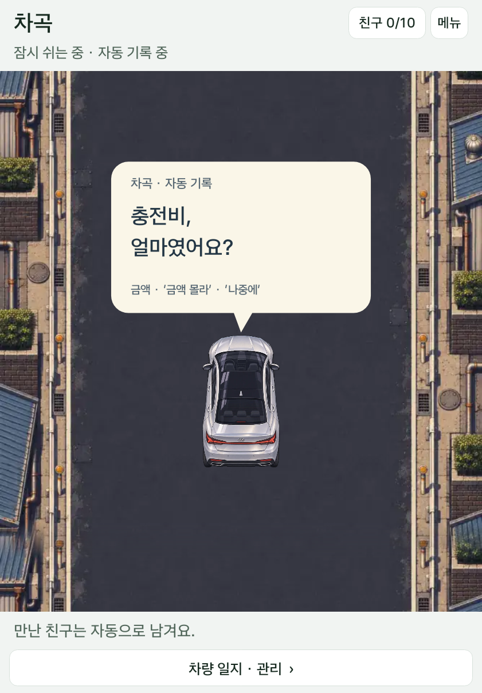
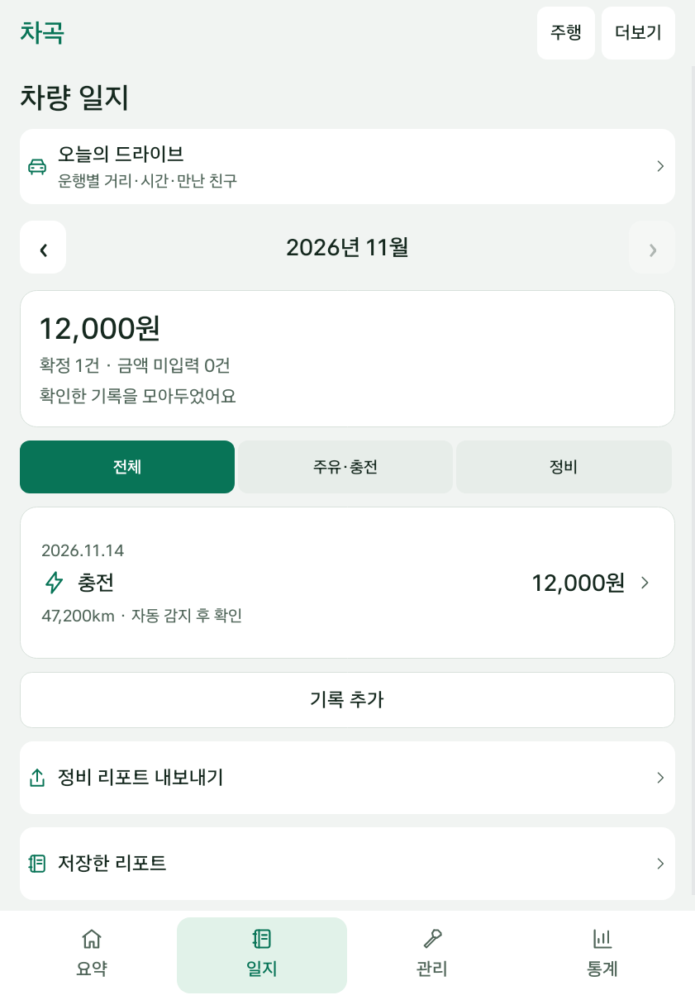
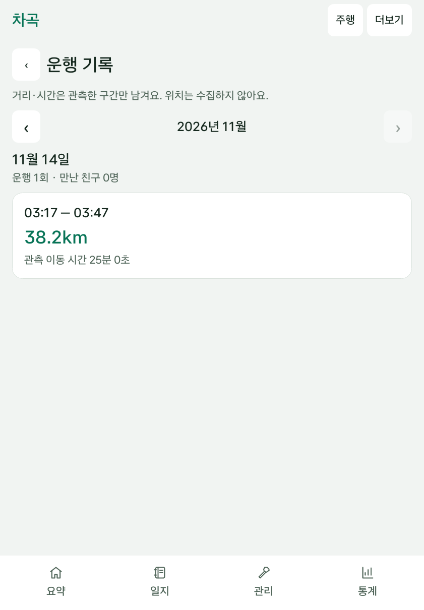
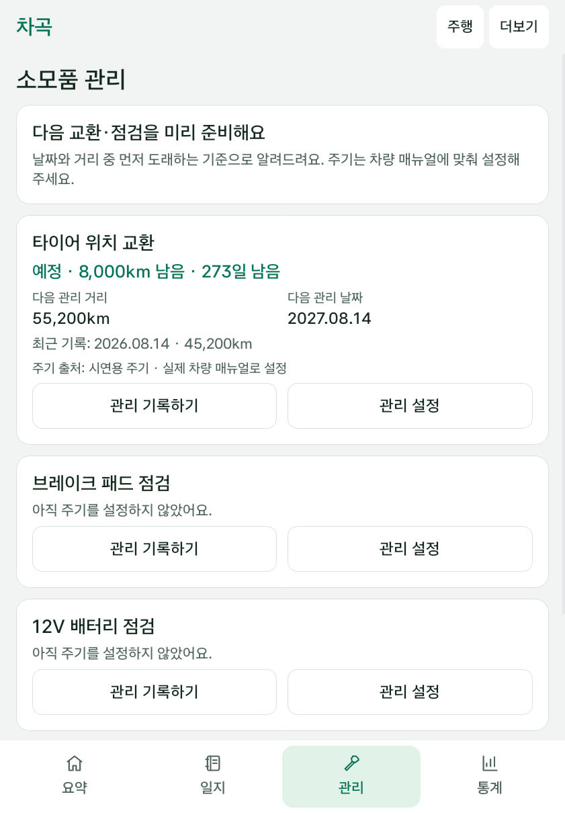
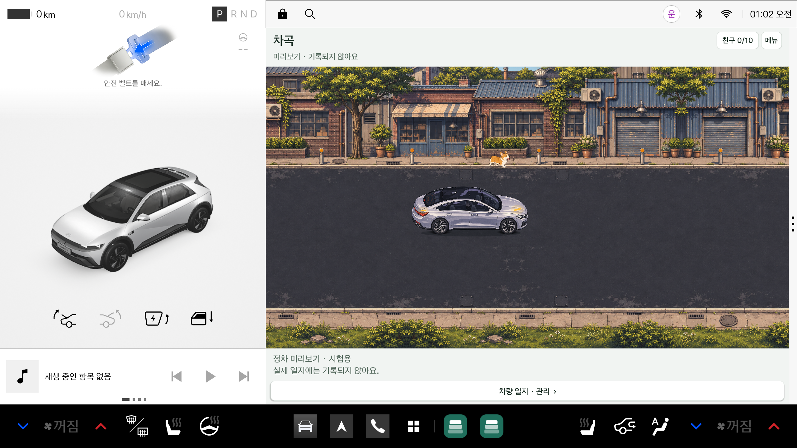
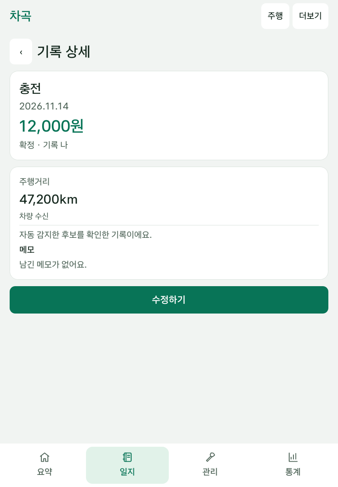
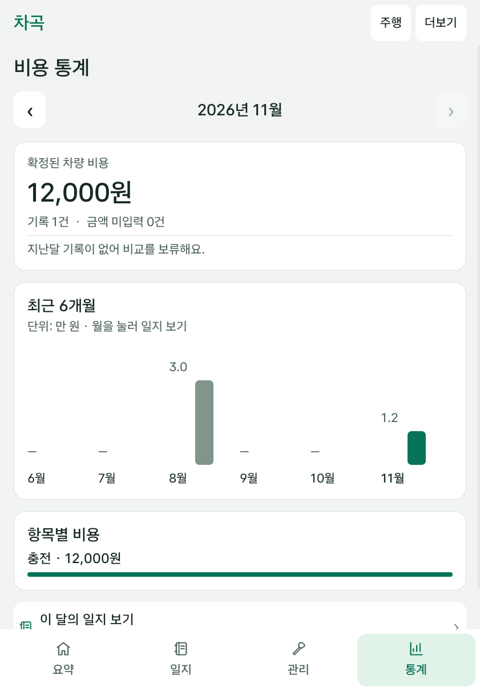
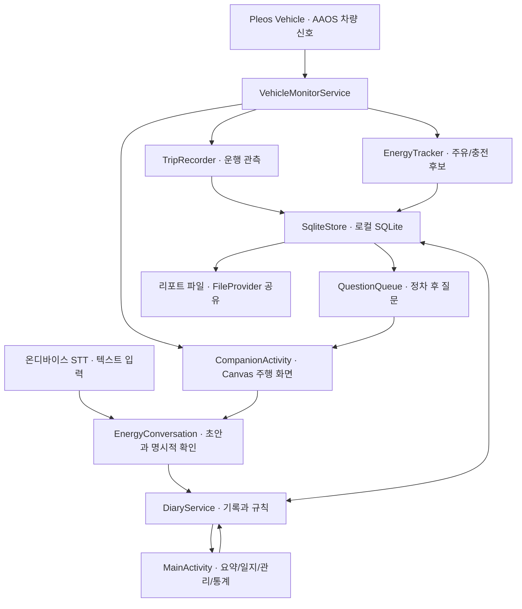

# 차곡 · chagok

**달리는 동안 차량 정보를 모으고, 정차 후 필요한 것만 확인하는 차량 일지.**

차곡은 **Pleos Connect / Android Automotive OS**에서 실행하는 차량용 앱입니다. 내비게이션 옆 작은 창에는 차와 풍경을, 화면 뒤에서는 운행과 주유·충전 후보를 남깁니다. 사용자는 매번 기록 버튼을 누르는 대신 금액처럼 차량이 알 수 없는 정보만 확인합니다. 나중에 정리된 일지·관리 일정·비용 통계를 열고 수정할 수도 있습니다.

## 한 장면으로 이해하기: 운행하고 충전한 하루

> **“목적지까지 달리고 충전했을 뿐인데, 오늘의 운행과 충전 기록이 정리되어 있다.”**
>
> 전기차로 38.2km를 이동합니다. 충전으로 배터리 잔량이 30%에서 80%로 올라갑니다. 차곡은 잔량 변화를 후보로 남겨 두고, 충전 후보가 정리된 뒤 정차 상태에서 금액을 묻습니다. “1만 2천 원”이라고 답하고 “맞아”라고 확인하면 일지와 이번 달 비용에 반영됩니다.

아래는 **현재 안드로이드 앱의 실제 View를 캡처한 화면**입니다. 같은 시연 데이터를 사용해 `841 × 1210dp`의 보조 창 크기로 렌더링했습니다. 운행 이력은 재현용 데이터이고, 충전 후보는 실제 감지 로직에 안정된 SoC 샘플을 넣어 생성했습니다. 음성 문장은 STT 결과가 도착하는 경로에 주입했습니다. 실차 주행이나 마이크 인식 성공을 증명하는 캡처는 아닙니다.

**첫 장면은 정차 중 주행 연출 미리보기입니다.** 현재 PLEOS 에뮬레이터가 주행 중 `NO_VIDEO` 제한을 전달하면 일반 앱은 애니메이션을 멈춥니다. 화면 표시와 백그라운드 자동 기록은 별도로 동작합니다. 움직이는 주행 연출의 배포 가능 범위는 [현재 제약](#현재-동작-범위와-남은-제약)을 확인하세요.

<table>
<tr>
<td width="50%"><b>① 내비 옆에 함께 두는 화면</b><br>별도의 운행 시작 버튼 없이 차량 신호를 관측합니다. 그림은 주행 연출 미리보기입니다.<br><br></td>
<td width="50%"><b>② 정차 후, 필요한 것만 묻기</b><br>SoC 상승으로 만든 충전 후보에 대해 “충전비, 얼마였어요?”라고 묻습니다.<br><br></td>
</tr>
<tr>
<td><b>③ 금액은 한 번 더 확인</b><br>“1만 2천 원”을 해석한 초안입니다. 이때 이번 달 비용에는 아직 더하지 않습니다.<br><br></td>
<td><b>④ ‘맞아’라고 하면 기록 완료</b><br>명시적으로 확인한 뒤 한 건의 충전 기록을 확정합니다. 침묵이나 화면 이탈로는 저장하지 않습니다.<br><br></td>
</tr>
<tr>
<td><b>⑤ 하루를 한눈에 확인</b><br>정차 후 차량 요약을 열면 오늘의 운행, 확인할 기록, 누적 거리와 다음 관리가 모여 있습니다.<br><br></td>
<td><b>⑥ 필요하면 기록을 열어 수정</b><br>확정된 충전 기록과 월 비용을 확인합니다. 상세 화면에서 날짜·금액·주행거리·메모 등을 수정할 수 있습니다.<br><br></td>
</tr>
</table>

이 시나리오의 결과는 **운행 1회 / 38.2km / 관측 이동 시간 25분**, **충전 기록 1건 / 이번 달 비용 12,000원**입니다. 관리 화면 설명을 위한 타이어 위치 교환 기록은 3개월 전 데이터여서 이번 달 비용에 포함되지 않습니다. 미리보기에서 본 친구도 수집 내역에 포함되지 않습니다.

캡처 생성 과정에서 **확인 전 0원 → 확인 후 12,000원**, 충전 기록 1건만 저장되는 것을 검사합니다. [시나리오 데이터](doc/readme/scenario.json) · [실행 결과](doc/readme/capture-result.txt) · [캡처 코드](app/src/androidTest/java/io/chagok/app/ReadmeScenarioCaptureTest.kt)

**문서 찾아보기:** [핵심 사용 방식](#핵심-사용-방식) · [현재 제약](#현재-동작-범위와-남은-제약) · [앱 구성](#앱-구성과-안드로이드-기본-개념) · [서드파티](#서드파티와-빌드-버전) · [개발 환경](#개발-환경-구축과-실행) · [테스트·캡처](#테스트와-화면-캡처-재현)

## 핵심 사용 방식

| 차곡이 자동으로 하는 일 | 사용자가 확인하는 일 | 필요할 때 여는 기능 |
|---|---|---|
| 속도·기어를 보고 운행 시작/종료 관측 | 주유·충전 금액과 저장 여부 | 운행 기록과 차량 일지 |
| 누적 거리로 관측 구간의 이동 거리 계산 | 잘못 감지한 후보 제외 | 기록 상세·수정·취소 |
| 안정된 연료·SoC 상승을 후보로 보관 | 모르는 금액은 미입력으로 저장 | 소모품 관리 주기와 알림 설정 |
| 화면 전환 중에도 자동 기록 유지 | 차량 종류와 사용자별 설정 | 월별·항목별 비용과 6개월 추이 |
| 확정 기록으로 일정·통계 다시 계산 | 매뉴얼을 참고한 관리 주기 설정 | 관리 도감·리포트 내보내기 |

앱의 기본 화면은 **주행 동반 화면**입니다. 정차했다고 차량 일지로 자동 이동하지 않습니다. 일지를 보고 싶을 때 하단의 **차량 일지 · 관리**를 열고, 다시 주행 화면으로 돌아옵니다.

## 1. 화면 뒤에서도 이어지는 자동 운행 기록

`VehicleMonitorService`가 알림을 표시하는 포그라운드 서비스로 차량 신호를 관측합니다. 내비게이션을 크게 열거나 차곡 화면을 벗어나도 서비스가 실행 중이면 수집이 이어집니다. 화면과 기록 수집의 수명을 분리했습니다.

| 상황 | 처리 |
|---|---|
| 유효한 속도가 0.5m/s를 초과 | 새 운행을 시작하거나 진행 중인 운행에 연결 |
| 잠깐 멈추거나 짧게 P단에 둠 | 같은 운행 유지 |
| P단·정지 상태가 120초 지속 | 운행 종료. 종료 시각은 정차가 시작된 시각으로 기록 |
| 누적 거리 수신 | 시작/종료 값의 차이로 관측 거리를 계산 |
| 속도·기어 수신이 끊김 | 끊긴 시간을 이동 시간으로 채우지 않고 누락 표시 |
| 사용자 변경·시계 역행·30분 초과 관측 공백 | 이전 운행을 불완전한 기록으로 닫아 잘못 이어 붙이지 않음 |
| 자동 기록 끄기 | 수집을 중단하고 다음 실행에도 선택 유지 |

운행 상태는 대략 5초마다 저장합니다. 프로세스가 다시 시작되면 저장된 체크포인트를 읽어 연속성을 판단합니다. 거리는 GPS 경로를 합산한 값이 아니며, 이동 시간도 앱이 관측한 구간만 셉니다. 신호가 없으면 0km나 0초로 정상 기록처럼 꾸미지 않습니다.

자동 기록이 켜져 있으면 부팅 완료와 앱 업데이트 후 수집 재개를 시도합니다. 시작 실패는 남겨 두고 앱을 다시 열 때 복구를 시도합니다. OS 강제 중지와 백그라운드 실행 제한까지 우회해 항상 실행된다는 의미는 아닙니다. [실제 재부팅 검증](doc/design/auto-diary-v10/boot-verification.json) · [Android 포그라운드 서비스 시작 제한](https://developer.android.com/develop/background-work/services/fgs/restrictions-bg-start)

<table>
<tr>
<td width="50%"><b>자동으로 모인 운행 기록</b><br></td>
<td width="50%"><b>거리와 날짜로 보는 다음 관리</b><br></td>
</tr>
</table>

## 2. 주유·충전은 감지하고, 비용은 확인받기

차곡은 내연기관·하이브리드에서는 **연료 잔량**, 전기차에서는 **배터리 SoC**를 관측합니다. 차량 종류는 프로필에서 설정합니다.

### 후보가 만들어지는 조건

1. 정차 상태에서 유효한 잔량 값이 들어옵니다.
2. 약 10초 동안 안정된 값을 기준으로 삼습니다. 안정 판정에는 1%p 허용 폭이 있습니다.
3. 기준에서 누적 상승량이 5%p 이상이면 주유·충전 후보를 만듭니다. 1%p씩 천천히 오르는 충전도 누적합니다.
4. 같은 상승 과정은 하나의 후보로 갱신합니다. 이미 확정·제외한 사건을 다시 비용으로 만들지 않습니다.
5. 움직임·잔량 하락 또는 상승 없는 시간이 이어지면 수집을 정리합니다. 변화가 없는 시간 기준은 연료 60초, SoC 30분입니다.

이는 **잔량 관측에 따른 추정**입니다. 충전 커넥터 해제나 결제 완료를 직접 읽는 기능은 아닙니다. 따라서 충전 직후 즉시 질문한다고 보장하지 않습니다. 2분을 넘는 관측 공백이 있으면 그 사실을 후보에 표시해 정차 중 연속 관측과 구분합니다.

연료·SoC의 퍼센트로 결제 금액, 주유량(L), 충전량(kWh)을 역산하지 않습니다. 양과 금액은 사용자가 확인하거나 입력하는 값입니다.

### 질문은 정차 후 짧게

자동 질문은 P단·정차 상태, 사용 가능한 음성 서비스, 통화 등의 방해가 없는 오디오 상태를 확인한 뒤 시작합니다. 같은 정차에서 질문을 연속으로 쏟아내지 않고, 준비된 오래된 후보부터 하나씩 확인합니다.

| 말하거나 발생한 상황 | 결과 |
|---|---|
| “1만 2천 원” | 12,000원 초안을 만들고 저장 여부 확인 |
| “맞아”, “저장해” | 확인 단계의 기록을 확정 |
| “2만 원이 아니라 1만 2천 원” | 수정한 금액으로 다시 확인 |
| “금액 몰라”, “금액 없이” | 금액 미입력 상태로 저장할지 확인 |
| “무료”, “공짜” | 명시적인 0원으로 저장할지 확인 |
| “나중에”, “취소”, 20초 무응답, 화면 이탈 | 비용에 넣지 않고 초안 유지 |
| “오늘은 묻지 마” | 그날 추가 질문을 쉬고 초안 유지 |
| “충전한 게 아니야”, “잘못 감지했어” | 후보 제외 |
| 같은 날 비슷한 기록이 이미 있음 | 중복 가능성을 알리고 정차 후 검토 안내 |

미룬 질문은 다음 정차 전환 및 최소 재질문 간격을 만족해야 다시 제안합니다. 금액을 이미 입력한 초안은 이어서 확인합니다. 후보와 초안, 질문 상태는 로컬에 저장됩니다.

## 3. 차량처럼 반응하는 주행 화면

차곡은 내비게이션의 옆 공간을 주요 사용 위치로 삼습니다. 전체 디스플레이 크기가 아니라 **실제로 배정받은 앱 창과 장면 영역의 크기**에 맞춰 그립니다. PLEOS도 애플리케이션 창의 가로·세로 배치를 안내합니다. [PLEOS 레이아웃 가이드](https://document.pleos.ai/docs/connect/guide/docs-design/getting-started/layout)

### 세로 창과 가로 창

| 항목 | 세로 장면 | 가로로 넓은 장면 |
|---|---|---|
| 주행 방향 | 화면 위쪽으로 전진 | 왼쪽에서 오른쪽으로 전진 |
| 차량 표현 | 위에서 내려다본 차량 | 옆면과 원근감이 있는 2.5D 차량 |
| 왼쪽 방향지시등 | 도로 왼쪽으로 부드럽게 이동 | 화면 위쪽의 먼 차선으로 이동 |
| 오른쪽 방향지시등 | 도로 오른쪽으로 부드럽게 이동 | 화면 아래쪽의 가까운 차선으로 이동 |
| 말풍선 | 차량보다 앞쪽인 위에 배치 | 차량 앞쪽의 오른쪽 위에 배치 |
| 배경 | 도로 좌우와 반복 아스팔트 분리 | 먼 배경·도로·가까운 배경의 이동 차이 |

장면 자체의 가로/세로 비율이 1.2 이상이면 가로 구성을 선택합니다. 단순히 기존 세로 그림을 늘리는 방식이 아니며, 차량·인물·건물의 비율을 유지합니다. 말풍선 꼬리는 짧게 붙이고 차와 함께 배치합니다.

아래는 가로 창에서 캡처한 **정차 중 미리보기**입니다. 두 스킨 모두 방향지시등 점멸과 차선 이동을 지원합니다.



[42초 안드로이드 가로 미리보기 영상](doc/design/landscape-v11/android-evidence/native-landscape-preview.mp4) · [가로·세로·두 스킨 비교 갤러리](doc/design/landscape-v11/index.html)

### 두 가지 스킨과 차량 신호

- **네온 레이서:** 초록 네온 말풍선과 가속 부스터. 속도 1m/s 초과·계산된 가속도 2.2m/s² 초과일 때 부스터를 연출합니다.
- **현대 세단:** 일반 차량의 모습과 밝은 말풍선. 같은 속도·차선 이동·깜빡이·비 연출을 사용합니다.
- 속도에 따라 도로가 흘러가는 정도를 바꿉니다. 가속도는 연속된 속도 표본에서 계산합니다.
- 좌우 이동은 **방향지시등 신호**에 반응합니다. 실제 조향각이나 내비게이션의 다음 회전 지시를 읽는 기능은 아닙니다.
- 스킨 선택은 로컬 사용자별로 유지됩니다. 실차 제어나 성능 향상 기능은 없습니다.

### 와이퍼로 표현하는 비

앞유리 와이퍼의 작동 근거가 60초 이어지면 비 연출을 시작합니다. 지원되는 수동 모드의 단계에 따라 빗방울 강도를 조절하고, OFF가 30초 이어지면 종료합니다.

AUTO는 실제 작동 여부를 함께 보고, 간헐 모드는 작동이 관측된 뒤 쉬는 구간을 처리합니다. MIST·SERVICE는 지속적인 비의 근거로 삼지 않습니다. 5초를 넘는 신호 공백은 판정을 초기화합니다. 실제 강우량이나 와이퍼의 물리적 왕복 횟수를 측정한 결과는 아닙니다.

### 가끔 만나는 10가지 장면

| 도시 장면 | 시골 장면 |
|---|---|
| 골목의 삼색이 · 노란 헬멧의 소녀 | 오리 가족 나들이 |
| 산책 대장 코기 · 파란 가방 배달원 | 귤 한 상자 |
| 꽃을 싣는 오후 · 빨간 우산의 인사 | 풍경을 담는 화가 |
| 골목 기타리스트 | |

장면을 선택할 때 도시는 75%, 시골은 25% 확률을 사용합니다. 이는 실제 운행 시간의 비율이나 도로 분류가 아닙니다. 직전 장면을 피하고, 선택한 환경 안에서 아직 만나지 않은 친구를 우선합니다.

만남은 실제로 화면에 1.5초 이상 보이고 차량을 지나간 경우에만 저장합니다. 같은 통과 사건은 중복 저장하지 않으며, 차량·로컬 사용자별로 첫 만남·최근 만남·횟수를 보관합니다. 화면 뒤에서 보이지 않은 사건, 미리보기, 연출이 제한된 동안에는 수집하지 않습니다.

## 4. 정차 후 열어 보는 차량 일지

화면은 **요약 / 일지 / 관리 / 통계** 네 탭과 보조 페이지로 나뉩니다. 좁은 창은 하단 탭, 넓은 창은 왼쪽 탐색 영역을 사용합니다. 작은 창에서도 필요한 내용부터 읽고 스크롤할 수 있으며, 주야간 색상과 공통 글꼴을 적용했습니다.

| 화면 | 할 수 있는 일 |
|---|---|
| 차량 요약 | 오늘의 운행, 확인할 기록, 누적 주행거리, 다음 관리 확인 |
| 차량 일지 | 월별 기록·합계·필터 확인, 기록 상세 열기 |
| 소모품 관리 | 다음 교환·점검의 거리/날짜, 주기·출처·알림·미루기 설정 |
| 비용 통계 | 월별 합계, 항목별 비용, 6개월 추이, 금액 미입력 건수 확인 |
| 운행 기록 | 날짜별 운행 거리·관측 이동 시간·만난 친구·미수신 안내 |
| 확인할 기록 | 감지 후보를 확인하거나 제외, 초안 이어서 처리 |
| 기록 추가 | 음성 또는 텍스트 입력, 항목을 직접 골라 기록 |
| 기록 상세 | 값의 출처와 변경 이력 확인, 수정·취소 |
| 자동 기록 설정 | 기록 켜기/끄기, 수신 상태·공백·질문 설정 확인 |
| 더보기 | 차량·사용자·공유 설정, 도감, 리포트 관리 |

차량 요약의 **확인할 기록** 카드와 **차량 누적 거리** 카드는 같은 행에서 높이를 맞춥니다. 글자 크기를 키우거나 내용이 늘어도 한쪽 텍스트를 잘라 높이를 맞추지 않습니다.

시연 데이터로 확인한 [PLEOS 대시보드 화면](doc/design/maintenance-dashboard/pleos-demo.png)과 [정비 항목 전체 목록](doc/design/maintenance-dashboard/demo-full-list.png)을 볼 수 있습니다.

### 지원하는 기록 항목

엔진오일·변속기 오일·브레이크 오일 교환, 드라이브 벨트·점화플러그·점화코일·에어컨 필터 교체, 타이어 위치 교환과 교체, 브레이크 패드 점검, 12V 배터리 점검과 교체, 와이퍼 점검, 워셔액 보충, 주유, 충전, 기타 정비, 증상 메모를 다룹니다.

엔진오일·변속기 오일·드라이브 벨트·점화플러그·점화코일·주유는 내연기관·하이브리드에 표시하고, 충전은 전기차에 표시합니다. 정비 항목별로 날짜나 거리 주기를 설정하면 차량 요약에 진행률과 예정일 또는 예정 거리가 표시됩니다. 증상 메모는 사용자가 느낀 소리나 떨림을 남기는 기능이며 고장 진단 결과가 아닙니다.

## 5. 기록의 근거와 수정 이력

차량 데이터와 사용자 입력을 섞어 출처를 잃지 않도록 주행거리 필드에 값·단위·출처·수신 시각·원래 관측값을 함께 보관합니다.

| 기록 규칙 | 이유와 동작 |
|---|---|
| `차량 수신 / 사용자 입력 / 앱 계산` 구분 | 자동으로 읽은 값인지 직접 바꾼 값인지 확인 가능 |
| 최근 차량 주행거리만 자동 첨부 | 10분을 넘긴 값이나 과거 정비에 오늘의 거리를 자동 첨부하지 않음 |
| 미수신과 0을 구분 | 연결 실패를 0km로 기록하지 않음 |
| 사용자 수정 시 원본 관측 보존 | 수정한 값과 당시 차량에서 읽은 값을 함께 추적 |
| 날짜 변경 시 자동 연결 재검토 | 현재 주행거리나 충전 후보를 엉뚱한 날짜에 붙이지 않음 |
| 초안·확정·취소 상태 분리 | 확인되지 않은 비용을 합계에 넣지 않음 |
| 확정 후 변경 이력 보존 | 수정 전후를 확인하고 비용·일정·도장 근거 다시 계산 |

상세 화면에서 날짜, 누적 거리, 금액, 메모, 타이어 위치, 주유량(L)/충전량(kWh), 엔진오일 제조사와 사용량(L)을 수정할 수 있습니다. 작성자만 수정·취소할 수 있습니다.

<table>
<tr>
<td width="50%"><b>출처까지 남기는 기록 상세</b><br></td>
<td width="50%"><b>확정 기록만 반영하는 비용 통계</b><br></td>
</tr>
</table>

## 6. 다음 관리, 비용, 관리 도감

### 관리 일정

사용자가 차량 매뉴얼 등을 참고해 거리·개월 주기와 출처를 지정하면 마지막 유효 기록을 기준으로 다음 관리 시점을 계산합니다. 거리와 날짜 중 먼저 도래한 조건을 표시하며, 말일·윤년·거리 미입력·누적 거리 역행·기록 취소를 처리합니다.

교환 항목과 점검 항목을 구분하고, 알림을 끄거나 특정 날짜까지 미룰 수 있습니다. 앱에 표시되는 시연용 `10,000km / 12개월`은 모든 차량에 적용할 권장 주기가 아닙니다.

### 비용 통계

**확정되고 취소되지 않은 기록만** 수행일 기준으로 합산합니다. 초안과 감지 후보는 제외됩니다. `금액 없음`은 `무료 0원`과 다르며 미입력 건수로 표시합니다. 기록 수정·취소 후 합계와 차트도 다시 계산합니다.

### 관리 도감

사용자의 확정 일지로 설명 카드와 선택형 미션을 만듭니다. 현재 이용 가능한 주제는 **일지 첫걸음**, **교환 주기 읽기**입니다. 타이어 알아보기와 내 차의 에너지는 준비 항목으로 남아 있습니다.

오답은 힌트를 보여 주고 다시 시도할 수 있습니다. 같은 주제의 도장을 중복 지급하지 않으며, 근거 기록이 취소되면 도장을 재검토 상태로 바꿉니다. 주행 화면의 “만난 친구들” 수집과는 별도 기능입니다.

### 정비소·주유소 방문 확인

더보기 → **정비소·주유소 방문 감지**에서 목록을 내려받거나 가져오고 위치 권한을 허용합니다. 새 위치와 P단·정차 신호가 확인된 경우, 단일 업체 60m 이내의 정차 관측 60초를 방문 후보로 남깁니다. 후보는 사용자 확인 전까지 일지가 아닙니다. 여러 업체가 겹치거나 오래된 위치이면 판단을 보류합니다.

정비 항목을 고르면 기존 일지 초안 화면에서 날짜·주행거리·금액을 확인하고 저장합니다. 주유 후보와 장소 방문이 함께 감지된 경우 날짜가 같은 유일한 미처리 연료 후보를 연결합니다. 앱 실행 공백 뒤 같은 장소가 다시 관측되면 공백 표시와 함께 확인 대상으로 남길 수 있지만, 공백 시간을 체류 시간으로 계산하지 않습니다.

목록은 최초 다운로드 후 하루 한 번 `ETag`로 변경을 확인하고 새 버전일 때만 전체 교체합니다. 검증 실패 시 기존 목록을 보존합니다. 정제한 전국 공개 목록 39,567곳을 [목록 스냅샷](data/places/README.md)으로 제공합니다. 앱 기본 다운로드 주소는 아직 설정하지 않았으며 파일 가져오기 또는 HTTPS 원문 주소 설정으로 사용할 수 있습니다. 공공 CSV 변환 도구도 제공합니다. [설정·데이터 형식·테스트 안내](doc/place-visits.md)


## 7. 음성 입력, 공용 일지, 리포트

### 음성 처리

Pleos SpeechToText의 `ON_DEVICE`, `ko-KR` 경로를 우선 사용합니다. 대체 경로도 Android 온디바이스 인식 엔진이 있을 때만 사용하고, 사용 불가하면 직접 입력을 안내합니다. 세션 제한·취소·오디오 포커스 상실을 처리합니다.

인식된 문장은 앱의 `UtteranceParser`가 항목·날짜·금액·수정·취소 의도로 해석합니다. 예를 들어 “타이어 위치 교환했어. 3만 원”으로 초안을 만들 수 있습니다. 현재 해석은 규칙과 발화 사전 기반이며 클라우드 LLM을 호출하지 않습니다. 앱은 원음을 보관하지 않습니다.

### 로컬 공용 일지

같은 차량 안에서 이름으로 로컬 사용자를 전환하고, 내 확정 기록의 열람 범위를 **모두 / 지정한 이름 / 나만**으로 설정합니다. 다른 사용자가 공유한 기록과 변경 내용을 볼 수 있으며 초안은 작성자 범위로 다룹니다.

이름 전환은 로그인·본인 인증이 아닙니다. 스마트폰 계정과 동기화하거나 차량 간 클라우드로 공유하는 기능도 없습니다. 운행 기록과 친구 수집은 해당 로컬 사용자 기준으로 표시합니다.

### 정비 리포트

기간·항목·메모 포함 여부를 정하고 내용을 미리 본 뒤 텍스트 파일로 저장합니다. 사용자별 보관함에서 다시 열기·공유·삭제할 수 있습니다. 리포트에는 VIN과 작성자 이름을 넣지 않습니다.

공유에는 `FileProvider`의 읽기 권한을 사용합니다. 저장한 파일은 생성 시점의 스냅샷이어서 일지를 나중에 수정해도 자동 갱신되지 않습니다. 에뮬레이터의 문서 선택기가 취소되는 환경에서도 앱 내부 파일 저장 경로를 사용할 수 있습니다.

## 현재 동작 범위와 남은 제약

### 주행 중 화면과 애니메이션은 별개

현재 에뮬레이터에서 내비 옆 차곡 창의 표시와 차량 신호 수신을 확인했습니다. 그러나 주행 중 `CarUxRestrictions.NO_VIDEO`가 전달되면 **일반 앱은 도로 이동·비·부스터·만남 애니메이션을 정지**합니다. 일지 편집·설정·학습 같은 조작 화면도 정차 제한을 따릅니다.

`distractionOptimized=true` 선언은 주행 중 모든 연출에 대한 PLEOS 배포 승인이나 허용을 뜻하지 않습니다. 테스트용 `ProbeActivity`에서 연출 제한을 분리해 신호 반응을 검증한 결과도 일반 앱의 정책 허용 근거로 사용하지 않습니다. 실제 차량에서 어느 범위까지 움직이는 동반 화면을 제공할지는 별도 검증이 남아 있습니다.

### 차량 SDK 연결 범위

| 데이터·기능 | 현재 사용 경로 | 구현 범위 / 해석 |
|---|---|---|
| 누적 주행거리 | Pleos Vehicle `Odometer.getCurrentDistanceDriven` | 권한·읽기 capability 확인, 수신 시각 보존 |
| 연료 잔량 | Pleos Vehicle Fuel API | 내연기관·하이브리드의 주유 후보 |
| 배터리 SoC | Pleos Vehicle EvBattery API | 전기차의 충전 후보 |
| 차량 속도·기어 | AAOS `CarPropertyManager` | 운행 상태, 속도 연출, 정차 판단 |
| 가속도 | 속도 표본의 차이 | 필터를 거친 앱 계산값, 별도 가속도 센서값 아님 |
| 방향지시등 | Pleos 차량 신호 | 좌우 차선 이동·깜빡이 연출, 조향각 아님 |
| 앞유리 와이퍼 | Pleos 차량 신호 | 일정 시간 작동을 근거로 비 연출 |
| 주행 UX 제한 | AAOS `CarUxRestrictionsManager` | 조작 화면 제한, `NO_VIDEO`에 따른 연출 정지 |
| 음성 인식 | Pleos STT / 사용 가능한 Android 온디바이스 엔진 | 정차 중 기록·금액 확인 |
| 내비게이션 데이터 | `NaviHelper`는 smoke 전용 의존성 | 일반 앱은 경로·도로 종류·회전 안내를 소비하지 않음 |

현재 포함되지 않은 기능은 다음과 같습니다.

- 실제 도로의 도시·시골·고속도로·지방도 분류, GPS 이동 경로, 카메라로 사람·동물 인식.
- 실시간 날씨 서비스, 실제 강우량 측정, 충전 결제·영수증 자동 조회.
- 다른 앱 위에 항상 뜨는 전역 버튼, 전역 호출어·백그라운드 마이크.
- 클라우드 동기화, 인증된 가족 계정, 스마트폰 연동, VIN 자동 등록·차량 간 기록 병합.
- 고장 진단, 차량 제어, LLM 상담, 영수증 OCR.

내비게이션 지도는 테스트 환경에서 빈 화면과 인증 오류를 관측했습니다. 그 원인을 SDK 제약 하나로 단정하거나 경로 연동까지 성공했다고 보지는 않습니다. [SDK 연동 검증](doc/design/companion-v6/android-integration.txt) · [분할 창 검증](doc/design/companion-v6/split-window-verification.txt)

현재 렌더 루프는 약 33ms 간격으로 다음 프레임을 요청합니다. 가로 화면 녹화 당시 에뮬레이터에서는 지연 프레임이 관측되었습니다(432프레임, jank 85.42%, 중앙 프레임 시간 85ms). **실차 30fps를 검증한 상태는 아닙니다.** [측정 근거](doc/design/landscape-v11/verification.json)

## 앱 구성과 안드로이드 기본 개념

단일 `app` 모듈의 Kotlin 안드로이드 앱입니다. 화면은 프로그램으로 구성하는 Android View와 Native Canvas를 사용합니다. Compose·WebView·웹 서버로 UI를 띄우는 구조가 아닙니다.



| 안드로이드 구성 요소 | 이 앱에서의 역할 |
|---|---|
| `Activity` | 사용자가 보는 창. 기본 진입은 `CompanionActivity`, 정차 후 일지 화면은 `MainActivity` |
| `View` / `Canvas` | 버튼·카드·탭과 주행 장면을 배치하고 그림. 창 크기 변화에 재배치 |
| `Service` | 화면이 사라져도 차량 관측을 이어 가는 `VehicleMonitorService` |
| `BroadcastReceiver` | 부팅 완료·패키지 교체 후 자동 기록 재개 시도 |
| `Intent` | 주행 화면에서 일지로 이동하거나 파일 공유 앱을 호출 |
| `SQLiteOpenHelper` | 앱 내부 데이터베이스 생성·버전 변경·읽기/쓰기 |
| `ContentProvider` | `FileProvider`로 선택한 리포트 파일만 임시 읽기 권한 부여 |
| `AndroidManifest.xml` | 자동차 기기 요구, 권한, 실행 화면·서비스·수신기 등록 |
| Gradle 빌드 변형 | 실제 사용용 `debug`, 별도 데이터의 테스트용 `smoke`, 현재 개발 서명인 `release` |

### 데이터와 수명

`SqliteStore`는 JSON으로 직렬화한 도메인 문서를 SQLite의 종류·ID·소유자 키로 보관합니다. 차량 프로필, 일지, 후보, 관리 계획, 도감 진행, 공유 설정, 운행, 기록 공백, 친구 만남 등을 저장합니다. 현재 스키마 버전은 3이며 이전 데이터 보존을 고려한 변경과 트랜잭션을 사용합니다.

차량 관측의 기록 주체는 서비스로 모았습니다. UI는 관측 상태를 받아 그리며, 사용자의 확인·수정은 `DiaryService`를 거칩니다. 차량 API 실패는 `Reading.Unavailable`로, 정상 값은 `Reading.Value(Observation)`로 표현합니다.

대략적인 수집 주기는 속도 구독 5Hz와 보조 조회 2초, 에너지 재조회 5초, 누적 거리 조회 30초, 운행 상태 처리 1초입니다. 이는 앱의 요청 주기이며 차량이 항상 해당 빈도로 유효한 새 데이터를 준다는 보장은 아닙니다.

### 파일을 어디서 수정하나

| 수정하려는 내용 | 주요 파일·폴더 |
|---|---|
| 기본 화면·말풍선·메뉴·정차 진입 | [CompanionActivity.kt](app/src/main/java/io/chagok/app/companion/CompanionActivity.kt) |
| 세로 도로·차량·비·부스터 | [CompanionSceneView.kt](app/src/main/java/io/chagok/app/companion/CompanionSceneView.kt) |
| 가로 2.5D 도로·차선·원근 | [LandscapeSceneRenderer.kt](app/src/main/java/io/chagok/app/companion/LandscapeSceneRenderer.kt) |
| 스킨·만남 목록·장면 선택 | [CompanionModel.kt](app/src/main/java/io/chagok/app/companion/CompanionModel.kt) |
| 이미지 리소스 | [companion assets](app/src/main/assets/companion) |
| 백그라운드 기록·재연결 | [VehicleMonitorService.kt](app/src/main/java/io/chagok/app/companion/VehicleMonitorService.kt) |
| 운행 종료·기록 공백·질문 순서 | [AutoDiary.kt](app/src/main/java/io/chagok/app/domain/AutoDiary.kt) |
| 금액 질문·확인 대화 | [EnergyConversation.kt](app/src/main/java/io/chagok/app/companion/EnergyConversation.kt) |
| 일지·통계·설정 화면 | [MainActivity.kt](app/src/main/java/io/chagok/app/ui/MainActivity.kt), [ui](app/src/main/java/io/chagok/app/ui) |
| 글꼴·색상·공통 카드·버튼 | [Ui.kt](app/src/main/java/io/chagok/app/ui/Ui.kt), [font](app/src/main/res/font) |
| 기록·후보·수정·공유 규칙 | [DiaryService.kt](app/src/main/java/io/chagok/app/domain/DiaryService.kt) |
| 잔량 상승 감지 | [Detection.kt](app/src/main/java/io/chagok/app/domain/Detection.kt) |
| 주기·비용·학습·발화 해석 | [domain](app/src/main/java/io/chagok/app/domain) |
| 저장 형식·마이그레이션 | [SqliteStore.kt](app/src/main/java/io/chagok/app/data/SqliteStore.kt), [Codec.kt](app/src/main/java/io/chagok/app/data/Codec.kt) |
| SDK 어댑터·속도·방향지시등·와이퍼 | [vehicle](app/src/main/java/io/chagok/app/vehicle) |
| 음성 인식·오디오 처리 | [SpeechInput.kt](app/src/main/java/io/chagok/app/speech/SpeechInput.kt) |
| 실제 주행 제한 | [DrivingState.kt](app/src/main/java/io/chagok/app/drive/DrivingState.kt) |
| JVM 로직 테스트 / 기기 UI 테스트 | [src/test](app/src/test), [src/androidTest](app/src/androidTest) |
| 테스트 전용 화면·SDK probe | [src/smoke](app/src/smoke) |

UI를 바꿀 때도 도메인의 “초안은 비용에서 제외”, “관측 공백은 채우지 않음”, “확정은 명시적 확인 뒤” 규칙은 유지합니다. 차량 연동 변경은 실제 API가 해당 기기에서 읽기 가능한지 capability·권한·미수신 경로까지 함께 확인해야 합니다.

## 서드파티와 빌드 버전

아래 버전은 이 저장소의 현재 Gradle 선언 기준입니다.

| 구성 | 버전 | 용도 |
|---|---|---|
| Android Gradle Plugin | 9.4.1 | Android 빌드, 내장 Kotlin 지원 |
| Gradle Wrapper | 9.8.2 | 프로젝트 공통 빌드 실행 |
| Gradle Daemon JVM | 25 | `gradle-daemon-jvm.properties`가 지정하는 빌드 실행 환경 |
| Java 소스/타깃 호환성 | 17 | 앱 컴파일 호환성. Gradle 실행 JDK와 구분 |
| Android SDK | compile 34 / target 34 / min 28 | Android API 기준 |
| Pleos Vehicle | 2.3.2 | 누적 거리·잔량·차량 신호 |
| Pleos SpeechToText | 3.3.1 | 온디바이스 음성 인식 |
| Pleos FusedLocation | 1.1.3 | 선택적 정비소·주유소 방문 후보 감지 |
| Pleos NaviHelper | 3.0.5 | **smoke 변형에만** 포함되는 SDK 가능 범위 조사 |
| AndroidX Core | 1.13.1 | Android 호환 기능·FileProvider |
| JUnit | 4.13.2 | JVM 테스트 |
| org.json | 20240303 | JVM 테스트에서 Android 스텁 대신 JSON 실행 |
| AndroidX Test Runner / Core | 1.6.2 / 1.6.1 | 기기 테스트 실행·ActivityScenario |
| AndroidX Test Ext JUnit / Espresso | 1.2.1 / 3.6.1 | Android 테스트와 UI 조작 |
| Asta Sans | 저장소에 포함된 폰트 | 한글 화면의 글꼴·굵기 통일 |

외부 Room ORM·DI 프레임워크·네트워크 클라이언트·클라우드 분석 SDK를 별도로 쓰지 않습니다. `SQLiteOpenHelper`, Android 기본 UI와 JSON 직렬화를 사용합니다. 도로·차량·만남 그림은 빌드에 포함된 PNG/WebP이며 실행 중 이미지 생성 서버를 호출하지 않습니다.

의존성 선언: [app/build.gradle.kts](app/build.gradle.kts) · [루트 build.gradle.kts](build.gradle.kts) · [settings.gradle.kts](settings.gradle.kts)

## 권한과 데이터 보관

| 권한 | 사용 이유 |
|---|---|
| `pleos.car.permission.CAR_DRIVE` | 누적 주행거리 |
| `pleos.car.permission.CAR_ENERGY` | 연료 잔량·SoC |
| `pleos.car.permission.CAR_LIGHTS` | 방향지시등 |
| `pleos.car.permission.CAR_WINDOWS` | 와이퍼 |
| `pleos.car.permission.STT_SERVICE` | Pleos 음성 서비스 |
| `android.permission.RECORD_AUDIO` | 사용자가 실행하는 음성 입력 |
| `android.car.permission.CAR_SPEED` | 속도 관측 |
| `android.car.permission.CAR_POWERTRAIN` | 기어 상태 |
| `FOREGROUND_SERVICE`, `FOREGROUND_SERVICE_SPECIAL_USE` | 화면 밖 자동 기록 서비스 |
| `POST_NOTIFICATIONS` | 자동 기록 상태 알림 |
| `RECEIVE_BOOT_COMPLETED` | 사용 설정에 따른 부팅 후 기록 재개 |

현재 매니페스트는 프로젝트에서 확인한 Normal·Dangerous 범위만 사용하며 signature·privileged 권한을 선언하지 않습니다. 권한 선언만으로 모든 차량에서 데이터 제공이 보장되는 것은 아닙니다.

앱의 일지 데이터는 앱 내부 SQLite에 저장하고 Android 자동 백업은 꺼 두었습니다. 선택 기능인 장소 방문 감지를 켜면 Pleos 위치 권한으로 위치를 읽어 차량 안에서 정비소·주유소 목록과 비교합니다. 인터넷 권한은 HTTPS 장소 목록 다운로드에 사용하며 좌표·일지·마이크 데이터는 전송하지 않습니다. 목록 주소는 사용자가 설정하며 기본 배포 주소는 아직 없습니다. [장소 목록 설정과 검증](doc/place-visits.md)을 참고하세요. 앱 삭제 또는 앱 데이터 지우기는 로컬 기록을 잃게 하므로 보관할 내용은 리포트로 내보내야 합니다. 리포트는 전체 DB 백업·복원 형식이 아닙니다.

정확한 선언: [AndroidManifest.xml](app/src/main/AndroidManifest.xml)

## 개발 환경 구축과 실행

실행 대상은 **Pleos Connect Emulator 또는 해당 차량 환경**입니다. 일반 Android 휴대전화 에뮬레이터에는 필요한 자동차 서비스가 없습니다. 앱은 `android.hardware.type.automotive`를 필수로 선언합니다. 현재 검증 기기는 Pleos Connect 2.1.0 / Android 14(API 34) 에뮬레이터입니다.

### 이미 구성된 Windows 작업 폴더

프로젝트 루트에서 PowerShell로 실행합니다.

```powershell
# 현재 터미널에 프로젝트 전용 Java·SDK·AVD 경로 적용
. .\tools\dev-env.ps1

# 빌드 → 에뮬레이터 부팅 → 설치 → 주행 화면 실행
.\tools\run-windows.ps1

# 이미 빌드한 APK 실행
.\tools\run-windows.ps1 -SkipBuild

# 같은 SDK·AVD 경로로 Android Studio 실행
.\tools\studio-windows.ps1
```

PowerShell 실행 정책으로 스크립트가 차단되면 현재 터미널에서만 `Set-ExecutionPolicy -Scope Process Bypass`를 적용합니다.

| 설치 항목 | 이 작업 폴더의 위치·설정 |
|---|---|
| Android Studio | `.dev/android-studio`, Rabbit 2 Patch 1 |
| 내장 Java | `.dev/android-studio/jbr`, JBR 25.0.4 |
| Android SDK | `.dev/android-sdk`, Platform API 34, Build-Tools 36.0.0, Platform-Tools, Emulator |
| Pleos 이미지 | `system-images/android-34/pleos_car_emulator/x86_64` |
| AVD | `.dev/android-user/avd/Chagok_Pleos_API_34.avd`, RAM 4GB, Cold boot |
| 에뮬레이터 가속 | Windows Hypervisor Platform(WHPX) |
| Gradle 캐시 | 사용자 프로필의 `.gradle` |
| SDK 경로 | Git에서 제외되는 `local.properties` |

`run-windows.ps1`은 `emulator-5554`를 사용합니다. 해당 포트에서 다른 AVD가 실행 중이지 않은지 확인하세요. 자동화용 Python 도구는 연결 기기가 하나인 환경을 전제로 합니다.

### 새 PC에 clone한 경우

`.dev`와 `local.properties`는 Git에서 제외됩니다. 저장소를 받은 것만으로 Android Studio·SDK·AVD가 설치되지는 않습니다. `dev-env.ps1`은 기존 로컬 설치 경로를 설정하는 스크립트이며 설치 도구가 아닙니다.

1. 현재 프로젝트의 AGP를 지원하는 Android Studio와 **JDK 25**를 준비합니다. 앱의 Java 호환성 17과 빌드 JVM 25를 혼동하지 마세요.
2. SDK Manager에서 Android SDK Platform 34, Build-Tools, Platform-Tools, Android Emulator를 설치합니다.
3. PLEOS 공식 가이드에 따라 SDK Update Site를 추가하고 Pleos API 34 시스템 이미지를 설치합니다. 운영체제·CPU에 맞는 이미지 주소를 사용합니다.
4. Device Manager에서 Automotive / Pleos AVD를 만들고 RAM 4GB, Cold boot를 설정합니다. Windows에서는 하드웨어 가상화와 에뮬레이터 가속 환경이 필요합니다.
5. `local.properties`에 실제 SDK 경로를 지정하고 `JAVA_HOME`, `ANDROID_HOME`, `adb` 경로를 맞춥니다.
6. Python 3를 설치하면 이 저장소의 기기 스모크·캡처 도구를 사용할 수 있습니다. Bash 시연 도구에는 별도 Bash·curl 환경이 필요합니다.

[PLEOS SDK·에뮬레이터 공식 설치 안내](https://document.pleos.ai/docs/connect/guide/getting-started/application-development/setup-connect-sdk-emulator)

Windows의 `local.properties` 예시(실제 설치 위치로 바꾸세요):

```properties
sdk.dir=D:/Android/Sdk
```

일반 경로에 설치했다면 `.dev` 전용 스크립트를 그대로 실행하는 대신 Android Studio와 Gradle Wrapper를 사용합니다. `.dev`와 같은 폴더 구조로 설치한 경우에만 기본 Windows 실행 스크립트를 재사용할 수 있습니다.

Pleos Maven 저장소는 `settings.gradle.kts`에 등록되어 있습니다. 첫 빌드에는 Gradle·의존성 다운로드를 위한 네트워크가 필요합니다.

```kotlin
maven { url = uri("https://nexus-playground.pleos.ai/repository/maven-releases/") }
```

### 빌드·설치 명령

```powershell
# JVM 로직 테스트: 에뮬레이터 없이 실행 가능
.\gradlew.bat :app:testSmokeUnitTest --console=plain

# 일반 앱 APK
.\gradlew.bat :app:assembleDebug --console=plain

# 실행 중인 Pleos 에뮬레이터에 설치하고 실행
adb install -r -g app/build/outputs/apk/debug/app-debug.apk
adb shell am start -n io.chagok.app/.companion.CompanionActivity
```

macOS/Linux에서는 같은 SDK 환경을 준비한 뒤 `./gradlew`로 실행합니다. Windows 전용 `.ps1` 도구는 사용할 수 없습니다. 이 저장소의 최신 실행 검증은 Windows 환경 기준입니다.

| 변형 | 패키지 | 용도·산출물 |
|---|---|---|
| debug | `io.chagok.app` | 일반 개발 앱, `app/build/outputs/apk/debug/app-debug.apk` |
| smoke | `io.chagok.app.smoke` | 격리된 테스트 앱, `app/build/outputs/apk/smoke/app-smoke.apk` |
| smoke AndroidTest | `io.chagok.app.smoke.test` | 기기 테스트 APK, `app/build/outputs/apk/androidTest/smoke/app-smoke-androidTest.apk` |
| release | `io.chagok.app` | 현재는 debug 서명·난독화 미사용인 개발 설정. 배포용 서명 구성 필요 |

## 테스트와 화면 캡처 재현

### 어떤 검증이 있는가

| 범위 | 확인하는 내용 |
|---|---|
| JVM 도메인 테스트 | 발화·금액 해석, 후보 누적 감지, 비용 합계, 주기 계산, 출처·수정, 직렬화 |
| 자동 일지 테스트 | 운행 분리·관측 공백·재개, 질문 미루기, 금액 미입력, 오탐 제외 |
| 실제 기기 UI 스모크 | 화면 이동, 저장·수정·취소, 일지·통계·SQLite 반영 |
| 차량 신호 스모크 | Virtual Console → 실제 SDK → 앱의 누적 거리·SoC·속도·방향지시등·와이퍼 |
| 크기별 시각 검증 | 좁은 창·보조 창·가로 창, 두 스킨, 말풍선·카드·글꼴·주야간 |
| 재부팅 검증 | 앱을 다시 열기 전 자동 기록 서비스 재개와 새 차량 값 수신 |
| README 시나리오 캡처 | 감지 후보 → 금액 초안 → 명시적 확정 → 일지·통계와 10개 화면 |

기기 스모크는 `.smoke` 앱의 DB만 초기화합니다. Virtual Console 신호는 에뮬레이터 전체에 영향을 주므로 주입 전에 일반 앱 수집을 멈추고, 끝나면 속도 0·P단 및 원래 SoC·와이퍼·방향지시등을 복구합니다. 누적 거리는 콘솔에서 감소가 제한되므로 기존 값보다 낮추지 않습니다.

### 전체 스모크 실행

Pleos 에뮬레이터를 먼저 켜고 실행합니다. 테스트 도중 같은 에뮬레이터에서 앱을 수동 조작하지 마세요.

```powershell
. .\tools\dev-env.ps1
.\tools\smoke-windows.ps1

# APK를 이미 빌드했다면
.\tools\smoke-windows.ps1 -SkipBuild
```

특정 테스트만 다시 실행하려면 설치된 smoke APK와 AndroidTest APK가 최신인지 확인하고 다음과 같이 지정합니다.

```powershell
python tools/smoke-device.py --class io.chagok.app.CompanionSmokeTest
python tools/smoke-device.py --class io.chagok.app.LandscapeUiSmokeTest
```

### README의 10개 화면 다시 만들기

```powershell
. .\tools\dev-env.ps1
.\gradlew.bat :app:assembleSmoke :app:assembleSmokeAndroidTest --console=plain
adb install -r -g app/build/outputs/apk/smoke/app-smoke.apk
adb install -r -g app/build/outputs/apk/androidTest/smoke/app-smoke-androidTest.apk
python tools/capture-readme.py
```

결과는 `doc/readme/images/`, 시나리오 수치는 `doc/readme/scenario.json`, 실행 결과는 `doc/readme/capture-result.txt`에 저장됩니다. 캡처 테스트는 명시적으로 해당 클래스를 지정할 때만 실행되며, 일반 전체 스모크에서는 건너뜁니다. 종료 후 일반 앱의 주행 화면을 다시 엽니다.

이 캡처는 실제 Android Activity·View·Canvas·도메인 로직·SQLite를 사용합니다. 원본 화면 픽셀을 저장하며 HTML 목업이나 이미지 생성으로 UI를 대신하지 않습니다. 고정된 시연용 운행 이력과 시간 진행, 주입한 음성 결과를 사용하므로 실차 운행·음성 인식·자동 질문 트리거 검증은 별도의 차량 스모크 결과를 봐야 합니다.

### 발표용 연속 시연

에뮬레이터에 시연 전용 `.smoke` 앱을 준비한 뒤 한 번의 명령으로 **주행 → 좌우 깜빡이 → 급가속·부스터 → 정차·주유 → 재출발 → 금액 확인·저장 → 약 2초 후 요약**을 재생할 수 있습니다.

```powershell
# 최초 빌드·설치 및 대기 화면
.\tools\demo-windows.ps1 -Mode Prepare -Build

# 준비된 시연 시작
.\tools\demo-windows.ps1 -Mode Play

# 전체 리허설과 저장 검증 후 다시 대기 화면으로
.\tools\demo-windows.ps1 -Mode Rehearse
```

속도·기어·깜빡이·누적 거리는 실제 에뮬레이터 SDK 경로를 사용합니다. 연료 `30% → 80%`와 답변 `5만 원 → 맞아`는 시연값을 재생합니다. 실제 감지·확정·SQLite·요약 화면을 사용하되, **주행 중 연출과 질문은 에뮬레이터 전용 예외**입니다. 일반 앱은 기존 주행 제한과 정차 후 질문을 유지합니다. 준비 시 시연 DB만 초기화하며 일반 앱의 기록은 보존합니다.

[시연 순서와 실행 안내](doc/demo/scenario.txt) · [초기 개발 대비 핵심 변경점](doc/demo/presentation-changes.txt)

### 보관된 검증 결과

서로 다른 개발 단계의 결과를 합쳐 전체 테스트 수처럼 표시하지 않습니다.

| 검증 단계 | 결과·근거 |
|---|---|
| 가로 주행·말풍선 개선 v11 | JVM **93개 통과**. 관련 기기 테스트 **17개 고유 사례 최종 통과**. 수정·재실행 내역 포함. [verification.json](doc/design/landscape-v11/verification.json) |
| 자동 일지 v10 | 당시 JVM 89개, 기기 26개 고유 사례 최종 통과. 현재 전체 결과와 별도로 보관. [verification.json](doc/design/auto-diary-v10/verification.json) |
| 자동 기록 재부팅 | 재부팅 후 앱 화면을 열지 않은 상태에서 서비스와 관측 재개 확인. [boot-verification.json](doc/design/auto-diary-v10/boot-verification.json) |
| 전체 UI 점검 v9 | 화면·대화상자·빈 상태·주야간 점검 기록. [검증 결과](doc/design/ui-v9/verification.json) |
| 이번 README 재현 | 시나리오 테스트 1개, 화면 10개와 확인 전후 비용 검증. [실행 로그](doc/readme/capture-result.txt), [메타데이터](doc/readme/scenario.json) |

### 실행 중 문제가 생기면

| 증상 | 먼저 확인할 것 |
|---|---|
| SDK 경로 오류 | `local.properties`와 `ANDROID_HOME`; 새 clone에는 `.dev`가 없음 |
| JDK/Gradle 불일치 | `java -version`, `gradlew.bat --version`, Daemon JVM 25 설정 |
| 차량 서비스 미연결 | 일반 휴대전화 이미지가 아닌 Pleos Automotive 이미지인지, 부팅 완료 여부 |
| 차량 값이 미수신 | 런타임 권한·읽기 capability·Virtual Console 상태; 미수신을 0으로 처리하지 않음 |
| 앱은 보이는데 도로가 정지 | 주행 중 `NO_VIDEO` 제한인지 확인. 정차 메뉴의 미리보기로 연출을 따로 확인 |
| 질문이 바로 나오지 않음 | 후보 수집 종료, P단, 음성 서비스·오디오 상태, 오늘 질문 쉬기 설정 |
| 음성이 안 들어옴 | 에뮬레이터 마이크 접근 설정과 음성 서비스. 예시 문장 주입은 마이크 테스트가 아님 |
| 테스트가 다른 기기로 연결 | `adb devices`로 연결 기기가 하나인지 확인 |
| Windows 스크립트 실행 차단 | 현재 프로세스의 PowerShell 실행 정책 확인 |

## 설계·검증 자료

| 자료 | 내용 |
|---|---|
| [시각 기획서 v4.2](doc/차곡_차량일지자동화_시각기획서_v4.2.html) | 원래 차량 일지 기획. 이후 구현 변경은 현재 README와 코드 기준 |
| [README 시나리오](doc/readme/scenario.json) | 현재 소개 화면의 데이터와 캡처 방식 |
| [가로 주행 v11](doc/design/landscape-v11/index.html) | 가로 2.5D·세로 대응·말풍선·카드 높이·영상 |
| [자동 일지 v10](doc/design/auto-diary-v10/index.html) | 자동 기록·운행·질문·설정·재부팅 검증 |
| [전체 UI v9](doc/design/ui-v9/index.html) | 일지·관리·통계·입력·대화상자의 디자인 점검 |
| [차량 SDK 검증 v6](doc/design/companion-v6/android-integration.txt) | 실제 차량 신호·제약·probe 구분 |
| [분할 창 검증](doc/design/companion-v6/split-window-verification.txt) | 내비와 차곡의 창 배치 및 표시 범위 |
| [가로 이미지 제작 기록](doc/design/landscape-v11/image-prompts.txt) | 배경·차량 이미지 생성 지시 |
| [만남 이미지 제작 기록](doc/design/landscape-v11/encounter-prompt.txt) | 가로 만남 장면 이미지 제작 |

초기 일지 중심 UI의 시연은 [이전 GIF](demo/chagok-demo.gif)와 [이전 영상](demo/chagok-demo.mp4)에 보관되어 있습니다. 현재 기본 화면이나 최신 기능을 보여 주는 자료는 이 README 앞부분과 v10·v11 자료입니다.

## 라이선스

프로젝트 코드 라이선스는 [MIT](LICENSE)입니다. Asta Sans에는 [SIL Open Font License](app/src/main/assets/licenses/AstaSans-OFL.txt)가 적용되며, 서드파티 SDK는 각각의 이용 조건을 따릅니다. 이미지 에셋은 저장소에 포함된 제작 결과물이며, 생성 지시는 위 설계 자료에 보관합니다.
